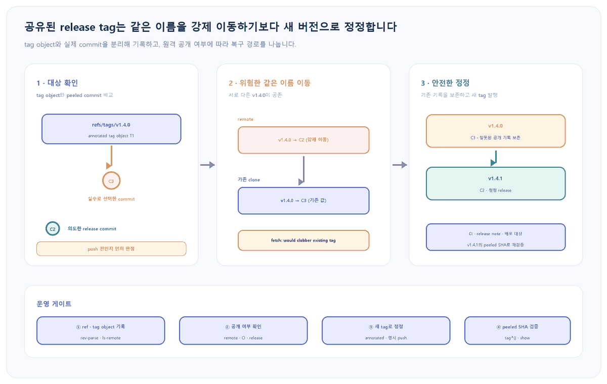

앞선 글 <a href="https://codersblog.github.io/posts/git-shallow-history-recovery/" style="color:var(--link-color);font-weight:700;text-decoration:underline;">shallow clone 이력 복원</a>은 CI가 tag와 ancestry를 충분히 내려받는 방법을 설명했지만, 그 tag가 올바른 commit을 가리킨다는 전제는 남겨 두었습니다. <a href="https://codersblog.github.io/posts/git-branch-rebase-push-merge-guide/" style="color:var(--link-color);font-weight:700;text-decoration:underline;">브랜치·rebase·push·PR 병합 흐름</a>도 branch 통합 이후 release 이름을 어떻게 고정하고 정정하는지는 다루지 않았습니다. 이번 글은 그 다음 단계로, 잘못된 tag가 이미 공유됐는지부터 판정해 같은 이름의 서로 다른 release가 생기는 사고를 막습니다.

대상 환경과 실패 증상

Windows PowerShell과 Git 2.x에서 annotated tag인 <code style="padding:2px 6px;border-radius:5px;background:var(--card-bg);color:var(--text-color);font-family:Consolas,'Courier New',monospace;">v1.4.0</code>을 push한 뒤 CI가 예상과 다른 commit을 빌드했거나, 내 clone의 tag SHA와 원격 조회 결과가 다르게 보이는 상황입니다. 배포를 잠시 멈추고 tag 이름, tag object, tag가 최종적으로 가리키는 commit을 각각 기록한 뒤 복구합니다.

<figure style="margin:24px 0 30px;padding:14px;border:1px solid var(--main-border-color);border-radius:14px;background:var(--card-bg);">

<figcaption style="margin:10px 4px 0;color:var(--text-muted-color);font-size:13px;text-align:center;">그림 1. 공개된 tag 이름을 강제로 재사용하면 clone마다 의미가 갈릴 수 있으므로, 기존 기록을 보존한 새 tag로 정정합니다.</figcaption>
</figure>
<h2 style="margin:34px 0 14px;padding-bottom:9px;border-bottom:2px solid var(--main-border-color);color:var(--heading-color);font-size:23px;">1. 배포를 멈추고 세 가지 object ID를 기록합니다</h2>
<pre style="margin:0 0 14px;padding:18px 20px;overflow:auto;border-radius:12px;background:var(--highlight-bg-color);color:var(--text-color);font-size:14px;line-height:1.55;"><code style="font-family:Consolas,'Courier New',monospace;">$tag = 'v1.4.0'
git status --short
git rev-parse "refs/tags/$tag"
git rev-parse "$tag^{commit}"
git ls-remote --tags origin "refs/tags/$tag*"</code></pre>

<strong>기대 관찰값:</strong> annotated tag라면 첫 rev-parse는 tag object SHA를, 두 번째는 tag를 벗겨 낸 commit SHA를 출력합니다. 원격 ls-remote도 tag object 행과 <code style="padding:2px 6px;border-radius:5px;background:var(--highlight-bg-color);color:var(--text-color);font-family:Consolas,'Courier New',monospace;">^{}</code>가 붙은 peeled commit 행을 보여 줍니다. 네트워크·인증 오류가 나면 원격 tag가 없다고 판단하지 말고 접속부터 복구합니다.

<h2 style="margin:34px 0 14px;padding-bottom:9px;border-bottom:2px solid var(--main-border-color);color:var(--heading-color);font-size:23px;">2. annotated tag와 lightweight tag를 같은 SHA로 읽지 않습니다</h2>
<pre style="margin:0 0 14px;padding:18px 20px;overflow:auto;border-radius:12px;background:var(--highlight-bg-color);color:var(--text-color);font-size:14px;line-height:1.55;"><code style="font-family:Consolas,'Courier New',monospace;">git cat-file -t v1.4.0
git for-each-ref `
  --format="%(refname:short) %(objecttype) %(objectname) %(*objectname)" `
  refs/tags/v1.4.0
git show --no-patch --decorate v1.4.0
git show --no-patch --format="%H %s" "v1.4.0^{commit}"</code></pre>
<table style="width:100%;margin:0 0 22px;border-collapse:collapse;border:1px solid var(--main-border-color);background:var(--card-bg);font-size:14px;">
<thead style="background:var(--highlight-bg-color);"><tr style="border-bottom:1px solid var(--main-border-color);"><th style="padding:11px 12px;border-right:1px solid var(--main-border-color);text-align:left;color:var(--heading-color);">종류</th><th style="padding:11px 12px;border-right:1px solid var(--main-border-color);text-align:left;color:var(--heading-color);">objecttype</th><th style="padding:11px 12px;text-align:left;color:var(--heading-color);">운영 의미</th></tr></thead>
<tbody style="color:var(--text-color);">
<tr style="border-bottom:1px solid var(--main-border-color);"><td style="padding:10px 12px;border-right:1px solid var(--main-border-color);">annotated</td><td style="padding:10px 12px;border-right:1px solid var(--main-border-color);">tag</td><td style="padding:10px 12px;">tagger·날짜·메시지·선택적 서명을 가진 release 기록</td></tr>
<tr><td style="padding:10px 12px;border-right:1px solid var(--main-border-color);">lightweight</td><td style="padding:10px 12px;border-right:1px solid var(--main-border-color);">보통 commit</td><td style="padding:10px 12px;">별도 tag object 없이 object를 가리키는 짧은 이름</td></tr>
</tbody></table>

release에는 메시지와 생성자 기록이 남는 annotated tag를 우선합니다. 단순히 <code style="padding:2px 6px;border-radius:5px;background:var(--highlight-bg-color);color:var(--text-color);font-family:Consolas,'Courier New',monospace;">git rev-parse v1.4.0</code>만 비교하면 한쪽은 tag object, 다른 쪽은 commit을 비교해 오진할 수 있으므로, 배포 대상은 항상 <code style="padding:2px 6px;border-radius:5px;background:var(--highlight-bg-color);color:var(--text-color);font-family:Consolas,'Courier New',monospace;">^{commit}</code>으로 확인합니다.

<h2 style="margin:34px 0 14px;padding-bottom:9px;border-bottom:2px solid var(--main-border-color);color:var(--heading-color);font-size:23px;">3. tag를 만든 뒤 대상 commit의 diff와 테스트를 다시 묶어 봅니다</h2>
<pre style="margin:0 0 14px;padding:18px 20px;overflow:auto;border-radius:12px;background:var(--highlight-bg-color);color:var(--text-color);font-size:14px;line-height:1.55;"><code style="font-family:Consolas,'Courier New',monospace;">git show --no-patch --format="%H%n%P%n%ad%n%s" `
  --date=iso-strict "v1.4.0^{commit}"
git diff --stat "v1.3.0^{commit}..v1.4.0^{commit}"
git branch --contains "v1.4.0^{commit}"
./scripts/test-release.ps1 "v1.4.0^{commit}"</code></pre>

<strong>진단 분기:</strong> tag SHA가 예상과 같아도 release 산출물이 틀렸다면 CI가 tag 이름 대신 branch tip이나 cache를 사용했을 수 있습니다. 반대로 peeled commit부터 틀리면 tag 대상 선정 문제입니다. 테스트 스크립트는 예시이므로 실제 프로젝트의 빌드·서명·smoke test 명령으로 바꾸고, 실패하면 tag 수정 전에 배포 중단 상태를 유지합니다.

<h2 style="margin:34px 0 14px;padding-bottom:9px;border-bottom:2px solid var(--main-border-color);color:var(--heading-color);font-size:23px;">4. 원격에 한 번도 공개되지 않았다면 로컬에서만 다시 만듭니다</h2>
<pre style="margin:0 0 14px;padding:18px 20px;overflow:auto;border-radius:12px;background:var(--highlight-bg-color);color:var(--text-color);font-size:14px;line-height:1.55;"><code style="font-family:Consolas,'Courier New',monospace;">$tag = 'v1.4.0'
$correct = '&lt;verified-release-commit&gt;'
git ls-remote --exit-code --tags origin "refs/tags/$tag"
# 종료 코드 2이고 원격 조회 자체는 정상일 때만 아래 실행
git tag -fa $tag -m "release 1.4.0" $correct
git show --no-patch "$tag^{commit}"
git push origin "refs/tags/$tag"</code></pre>

<strong>안전 조건:</strong> 원격에 tag가 없고, release 페이지·CI artifact·다른 mirror에도 공개되지 않았다는 증거가 있을 때만 같은 이름을 다시 사용합니다. <code style="padding:2px 6px;border-radius:5px;background:var(--highlight-bg-color);color:var(--text-color);font-family:Consolas,'Courier New',monospace;">--exit-code</code>의 2는 통신은 성공했지만 일치 ref가 없다는 뜻입니다. 일반 오류 1이나 인증 실패를 “미공개”로 읽지 않습니다.

<h2 style="margin:34px 0 14px;padding-bottom:9px;border-bottom:2px solid var(--main-border-color);color:var(--heading-color);font-size:23px;">5. 이미 공유됐다면 기존 이름을 보존하고 새 tag로 정정합니다</h2>
<pre style="margin:0 0 14px;padding:18px 20px;overflow:auto;border-radius:12px;background:var(--highlight-bg-color);color:var(--text-color);font-size:14px;line-height:1.55;"><code style="font-family:Consolas,'Courier New',monospace;">$correct = '&lt;verified-release-commit&gt;'
git tag -a v1.4.1 -m "release 1.4.0 corrected target" $correct
git show --no-patch "v1.4.1^{commit}"
git push origin refs/tags/v1.4.1
git ls-remote --tags origin 'refs/tags/v1.4.1*'</code></pre>

<strong>기대 관찰값:</strong> 원격에는 잘못된 v1.4.0과 정정된 v1.4.1이 함께 남고, v1.4.1의 peeled SHA가 검증한 commit과 같습니다. release note에는 v1.4.0을 사용 중지하고 v1.4.1로 교체한 이유와 이전·새 SHA를 남깁니다.

<strong>중단 기준:</strong> tag 보호 규칙이나 권한이 push를 거부하면 force로 우회하지 않습니다. 담당자의 release 절차를 따르고, tag와 branch를 함께 공개해야 하며 서버가 지원한다면 <code style="padding:2px 6px;border-radius:5px;background:var(--highlight-bg-color);color:var(--text-color);font-family:Consolas,'Courier New',monospace;">git push --atomic origin refs/heads/release/1.4 refs/tags/v1.4.1</code>처럼 전부 성공하거나 전부 실패하게 묶습니다.

<h2 style="margin:34px 0 14px;padding-bottom:9px;border-bottom:2px solid var(--main-border-color);color:var(--heading-color);font-size:23px;">6. 같은 이름이 이미 강제 이동됐다면 stale clone을 명시적으로 복구합니다</h2>
<pre style="margin:0 0 14px;padding:18px 20px;overflow:auto;border-radius:12px;background:var(--highlight-bg-color);color:var(--text-color);font-size:14px;line-height:1.55;"><code style="font-family:Consolas,'Courier New',monospace;">git fetch --tags origin
# would clobber existing tag가 나오면 기존 대상을 먼저 보존
git tag archive/v1.4.0-old "v1.4.0^{commit}"
git tag -d v1.4.0
git fetch origin refs/tags/v1.4.0:refs/tags/v1.4.0
git rev-parse archive/v1.4.0-old^{commit}
git rev-parse v1.4.0^{commit}</code></pre>

Git은 이미 받은 tag를 일반 fetch로 뒤에서 덮어쓰지 않습니다. 위 절차는 조직이 같은 이름의 tag를 이미 강제 이동했고 그 결정을 별도 채널에서 확인한 뒤, clone 하나를 맞추는 복구입니다. archive tag는 이전 commit을 보존하지만 원래 annotated tag의 메시지·서명 객체를 대체하지 않으므로, 삭제 전 <code style="padding:2px 6px;border-radius:5px;background:var(--highlight-bg-color);color:var(--text-color);font-family:Consolas,'Courier New',monospace;">git cat-file -p v1.4.0</code> 출력과 tag object SHA도 사고 기록에 남깁니다.

<h3 style="margin:30px 0 12px;color:var(--heading-color);font-size:19px;">격리 실험 결과</h3>

<strong>Git 2.54.0.windows.1:</strong> 로컬 bare 원격에서 annotated v1.4.0을 잘못된 C3에 push했습니다. 올바른 C2에는 새 v1.4.1을 만들어 push했고 원격 peeled SHA가 C2임을 확인했습니다. 같은 v1.4.0을 C2로 바꾼 일반 push는 종료 코드 1로 거부됐습니다. 실험 목적으로 force push한 뒤 기존 clone의 <code style="padding:2px 6px;border-radius:5px;background:var(--card-bg);color:var(--text-color);font-family:Consolas,'Courier New',monospace;">fetch --tags</code>도 종료 코드 1과 clobber 거부를 보였고, 그 clone은 계속 C3을 가리켰습니다. 이전 C3을 archive tag로 보존하고 로컬 v1.4.0을 삭제한 뒤 exact refspec으로 다시 받자 C2로 일치했으며 working tree는 clean이었습니다. 실제 GitHub 보호 규칙·release page·배포 롤백은 이 로컬 실험 범위 밖입니다.

<h2 style="margin:34px 0 14px;padding-bottom:9px;border-bottom:2px solid var(--main-border-color);color:var(--heading-color);font-size:23px;">7. 넓은 tag push와 삭제 후 재생성을 기본 절차로 쓰지 않습니다</h2>
<pre style="margin:0 0 14px;padding:18px 20px;overflow:auto;border-radius:12px;background:var(--highlight-bg-color);color:var(--text-color);font-size:14px;line-height:1.55;"><code style="font-family:Consolas,'Courier New',monospace;"># 피할 기본값
git push --tags
git push --force --tags
git push --delete origin v1.4.0

# 권장: 검증한 하나만 명시
git push origin refs/tags/v1.4.1</code></pre>

모든 로컬 tag를 한꺼번에 push하면 임시·개인 tag까지 공개될 수 있습니다. force와 delete는 이미 내려받은 clone을 자동으로 정리하지 않아 같은 이름의 서로 다른 release를 더 오래 남깁니다. 보안 사고처럼 기존 tag를 반드시 제거해야 한다면, 삭제 자체보다 영향받은 artifact·clone·cache 목록과 재발행 절차를 먼저 확정합니다.

<h2 style="margin:34px 0 14px;padding-bottom:9px;border-bottom:2px solid var(--main-border-color);color:var(--heading-color);font-size:23px;">운영 판단표</h2>
<table style="width:100%;margin:0 0 22px;border-collapse:collapse;border:1px solid var(--main-border-color);background:var(--card-bg);font-size:14px;">
<thead style="background:var(--highlight-bg-color);"><tr style="border-bottom:1px solid var(--main-border-color);"><th style="padding:11px 12px;border-right:1px solid var(--main-border-color);text-align:left;color:var(--heading-color);">관찰</th><th style="padding:11px 12px;border-right:1px solid var(--main-border-color);text-align:left;color:var(--heading-color);">판단</th><th style="padding:11px 12px;text-align:left;color:var(--heading-color);">조치</th></tr></thead>
<tbody style="color:var(--text-color);">
<tr style="border-bottom:1px solid var(--main-border-color);"><td style="padding:10px 12px;border-right:1px solid var(--main-border-color);">원격 ref 없음·소비 흔적 없음</td><td style="padding:10px 12px;border-right:1px solid var(--main-border-color);">미공개</td><td style="padding:10px 12px;">로컬 tag 재생성 후 하나만 push</td></tr>
<tr style="border-bottom:1px solid var(--main-border-color);"><td style="padding:10px 12px;border-right:1px solid var(--main-border-color);">원격·CI·release 중 하나라도 존재</td><td style="padding:10px 12px;border-right:1px solid var(--main-border-color);">공유됨</td><td style="padding:10px 12px;">기존 보존, 새 버전 tag 발행</td></tr>
<tr style="border-bottom:1px solid var(--main-border-color);"><td style="padding:10px 12px;border-right:1px solid var(--main-border-color);">fetch가 clobber 거부</td><td style="padding:10px 12px;border-right:1px solid var(--main-border-color);">같은 이름이 갈라짐</td><td style="padding:10px 12px;">이전 대상 보존 후 exact refetch</td></tr>
<tr><td style="padding:10px 12px;border-right:1px solid var(--main-border-color);">tag는 맞지만 artifact가 다름</td><td style="padding:10px 12px;border-right:1px solid var(--main-border-color);">CI 입력·cache 문제</td><td style="padding:10px 12px;">peeled SHA와 artifact provenance 비교</td></tr>
</tbody></table>
<h2 style="margin:34px 0 14px;padding-bottom:9px;border-bottom:2px solid var(--main-border-color);color:var(--heading-color);font-size:23px;">마무리</h2>
<ul style="margin:0 0 24px;padding-left:24px;color:var(--text-color);">
<li style="margin:8px 0;">tag 이름, tag object SHA, peeled commit SHA를 따로 기록합니다.</li>
<li style="margin:8px 0;">원격 조회 실패와 원격 tag 부재를 구분합니다.</li>
<li style="margin:8px 0;">미공개일 때만 같은 이름을 로컬에서 다시 만듭니다.</li>
<li style="margin:8px 0;">공유된 tag는 보존하고 새 버전 tag로 정정합니다.</li>
<li style="margin:8px 0;">강제 이동이 이미 일어났다면 clone별 이전 대상을 보존한 뒤 명시적으로 맞춥니다.</li>
</ul>
<h2 style="margin:34px 0 14px;padding-bottom:9px;border-bottom:2px solid var(--main-border-color);color:var(--heading-color);font-size:23px;">공식 출처</h2>
<ul style="margin:0 0 28px;padding-left:24px;color:var(--text-color);">
<li style="margin:8px 0;"><a href="https://git-scm.com/docs/git-tag" style="color:var(--link-color);font-weight:700;text-decoration:underline;">Git 공식 문서: git-tag</a> — annotated·lightweight tag, 검증, 재태깅과 공유 후 새 이름 원칙</li>
<li style="margin:8px 0;"><a href="https://git-scm.com/docs/git-push" style="color:var(--link-color);font-weight:700;text-decoration:underline;">Git 공식 문서: git-push</a> — tag refspec, force, delete, atomic, follow-tags 동작</li>
<li style="margin:8px 0;"><a href="https://git-scm.com/docs/git-ls-remote" style="color:var(--link-color);font-weight:700;text-decoration:underline;">Git 공식 문서: git-ls-remote</a> — 원격 tag object와 peeled object ID 조회</li>
<li style="margin:8px 0;"><a href="https://git-scm.com/docs/git-for-each-ref" style="color:var(--link-color);font-weight:700;text-decoration:underline;">Git 공식 문서: git-for-each-ref</a> — ref objecttype, objectname, peeled field 출력</li>
<li style="margin:8px 0;"><a href="https://git-scm.com/docs/git-rev-parse" style="color:var(--link-color);font-weight:700;text-decoration:underline;">Git 공식 문서: git-rev-parse</a> — ^{commit}, ^{tag}, ^{} dereference 문법</li>
<li style="margin:8px 0;"><a href="https://git-scm.com/docs/git-show-ref" style="color:var(--link-color);font-weight:700;text-decoration:underline;">Git 공식 문서: git-show-ref</a> — exact ref 확인과 tag dereference</li>
<li style="margin:8px 0;"><a href="https://git-scm.com/docs/git-show" style="color:var(--link-color);font-weight:700;text-decoration:underline;">Git 공식 문서: git-show</a> — tag 메시지와 참조 object 검사</li>
<li style="margin:8px 0;"><a href="https://git-scm.com/book/en/v2/Git-Basics-Tagging" style="color:var(--link-color);font-weight:700;text-decoration:underline;">Pro Git: Tagging</a> — tag 생성·공유·삭제의 기본 흐름</li>
</ul>

