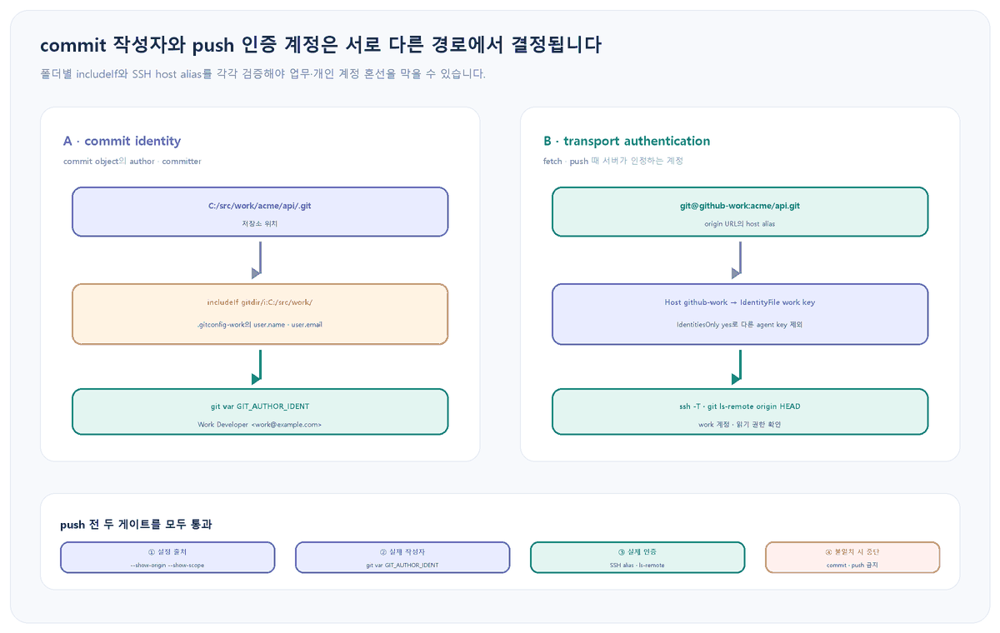

앞선 글 <a href="https://codersblog.github.io/posts/git-config-alias-customization/" style="color:var(--link-color);font-weight:700;text-decoration:underline;">.gitconfig와 alias로 설정 충돌 찾기</a>는 system·global·local·worktree 범위와 설정 출처를 다뤘지만, 한 PC에서 업무·개인 계정을 동시에 쓰는 경우는 남겨 두었습니다. 여기서는 그 다음 단계로, 저장소 위치에 따라 commit의 이름·이메일을 고르고 원격 URL에 따라 SSH 키를 고르는 두 흐름을 분리합니다.

대상 환경과 실패 증상

Windows PowerShell, Git 2.x, OpenSSH에서 GitHub 업무 계정과 개인 계정을 함께 사용합니다. 업무 저장소의 commit에 개인 이메일이 들어가거나, author는 업무 이메일인데 push가 개인 계정의 SSH 키로 인증되어 권한 거부 또는 잘못된 계정 활동으로 보이는 상황을 해결합니다. 이미 공유된 commit을 곧바로 rewrite하지 말고 먼저 두 identity의 출처를 기록합니다.

<figure style="margin:24px 0 30px;padding:14px;border:1px solid var(--main-border-color);border-radius:14px;background:var(--card-bg);">

<figcaption style="margin:10px 4px 0;color:var(--text-muted-color);font-size:13px;text-align:center;">그림 1. commit 작성자와 원격 인증 계정은 별개이므로, 폴더 조건과 SSH 키 선택을 각각 검증합니다.</figcaption>
</figure>

<h2 style="margin:34px 0 14px;padding-bottom:9px;border-bottom:2px solid var(--main-border-color);color:var(--heading-color);font-size:23px;">1. 변경 전에 두 identity의 현재값과 출처를 기록합니다</h2>
<pre style="margin:0 0 14px;padding:18px 20px;overflow:auto;border-radius:12px;background:var(--highlight-bg-color);color:var(--text-color);font-size:14px;line-height:1.55;"><code style="font-family:Consolas,'Courier New',monospace;">git status --short --branch
git remote -v
git config --show-origin --show-scope --get-regexp `
  '^(user\.(name|email|useConfigOnly)|includeIf\..*\.path|core\.sshCommand)$'
git var GIT_AUTHOR_IDENT
git var GIT_COMMITTER_IDENT
git log -1 --format='%h | author=%an &lt;%ae&gt; | committer=%cn &lt;%ce&gt;'</code></pre>

<strong>기대 관찰값:</strong> 설정 목록에는 값뿐 아니라 global·local 범위와 실제 파일 경로가 함께 나오고, <code style="padding:2px 6px;border-radius:5px;background:var(--highlight-bg-color);color:var(--text-color);font-family:Consolas,'Courier New',monospace;">git var</code>에는 다음 commit에 들어갈 작성자 정보가 표시됩니다. 마지막 log는 이미 만들어진 commit의 기록이므로, 현재 설정과 달라도 자동으로 바뀌지 않습니다.

<table style="width:100%;margin:0 0 24px;border-collapse:collapse;border:1px solid var(--main-border-color);background:var(--card-bg);font-size:14px;">
<thead style="background:var(--highlight-bg-color);"><tr style="border-bottom:1px solid var(--main-border-color);"><th style="padding:11px 12px;border-right:1px solid var(--main-border-color);text-align:left;color:var(--heading-color);">관찰</th><th style="padding:11px 12px;border-right:1px solid var(--main-border-color);text-align:left;color:var(--heading-color);">문제 영역</th><th style="padding:11px 12px;text-align:left;color:var(--heading-color);">다음 확인</th></tr></thead>
<tbody style="color:var(--text-color);">
<tr style="border-bottom:1px solid var(--main-border-color);"><td style="padding:10px 12px;border-right:1px solid var(--main-border-color);">git var가 개인 이메일</td><td style="padding:10px 12px;border-right:1px solid var(--main-border-color);">commit identity</td><td style="padding:10px 12px;">includeIf와 user 설정 출처</td></tr>
<tr style="border-bottom:1px solid var(--main-border-color);"><td style="padding:10px 12px;border-right:1px solid var(--main-border-color);">author는 맞지만 push 거부</td><td style="padding:10px 12px;border-right:1px solid var(--main-border-color);">transport 인증</td><td style="padding:10px 12px;">origin host와 SSH key</td></tr>
<tr style="border-bottom:1px solid var(--main-border-color);"><td style="padding:10px 12px;border-right:1px solid var(--main-border-color);">author와 committer가 다름</td><td style="padding:10px 12px;border-right:1px solid var(--main-border-color);">환경 변수·rebase</td><td style="padding:10px 12px;">GIT_AUTHOR_*·GIT_COMMITTER_* 존재 여부</td></tr>
<tr><td style="padding:10px 12px;border-right:1px solid var(--main-border-color);">설정은 맞지만 이전 commit이 틀림</td><td style="padding:10px 12px;border-right:1px solid var(--main-border-color);">과거 object</td><td style="padding:10px 12px;">공유 여부와 rewrite 경계</td></tr>
</tbody></table>

<h2 style="margin:34px 0 14px;padding-bottom:9px;border-bottom:2px solid var(--main-border-color);color:var(--heading-color);font-size:23px;">2. user.useConfigOnly로 추측된 기본 identity를 차단합니다</h2>

Git은 이름과 이메일이 없을 때 OS 사용자와 호스트 정보로 값을 추측할 수 있습니다. 다중 계정 PC에서는 조용히 잘못된 commit을 만드는 것보다 identity가 없는 새 저장소에서 commit을 실패시키는 편이 안전합니다.

<pre style="margin:0 0 14px;padding:18px 20px;overflow:auto;border-radius:12px;background:var(--highlight-bg-color);color:var(--text-color);font-size:14px;line-height:1.55;"><code style="font-family:Consolas,'Courier New',monospace;">git config --global user.useConfigOnly true
git config --global --show-origin --get user.useConfigOnly

# 아직 identity 규칙이 없는 시험 저장소에서 확인
New-Item -ItemType Directory C:/src/unclassified/identity-test
git -C C:/src/unclassified/identity-test init
git -C C:/src/unclassified/identity-test commit --allow-empty -m "must stop"</code></pre>

<strong>기대 관찰값:</strong> 마지막 commit은 author identity가 없다는 오류와 함께 실패합니다. 기존 global user.name·user.email이 남아 있으면 그 값이 계속 적용되므로, 먼저 <code style="padding:2px 6px;border-radius:5px;background:var(--highlight-bg-color);color:var(--text-color);font-family:Consolas,'Courier New',monospace;">--show-origin</code>으로 확인하고 제거 여부는 모든 저장소의 영향 범위를 검토한 뒤 결정합니다.

<h2 style="margin:34px 0 14px;padding-bottom:9px;border-bottom:2px solid var(--main-border-color);color:var(--heading-color);font-size:23px;">3. includeIf로 업무·개인 폴더의 작성자를 나눕니다</h2>

저장소를 <code style="padding:2px 6px;border-radius:5px;background:var(--highlight-bg-color);color:var(--text-color);font-family:Consolas,'Courier New',monospace;">C:/src/work/</code>와 <code style="padding:2px 6px;border-radius:5px;background:var(--highlight-bg-color);color:var(--text-color);font-family:Consolas,'Courier New',monospace;">C:/src/personal/</code> 아래로 구분합니다. Windows처럼 경로 대소문자가 흔들릴 수 있는 환경에서는 <code style="padding:2px 6px;border-radius:5px;background:var(--highlight-bg-color);color:var(--text-color);font-family:Consolas,'Courier New',monospace;">gitdir/i</code>를 사용하고 경로 끝의 슬래시로 하위 저장소 전체를 포함합니다.

<pre style="margin:0 0 14px;padding:18px 20px;overflow:auto;border-radius:12px;background:var(--highlight-bg-color);color:var(--text-color);font-size:14px;line-height:1.55;"><code style="font-family:Consolas,'Courier New',monospace;">git config --global --add `
  'includeIf.gitdir/i:C:/src/work/.path' `
  'C:/Users/lee/.gitconfig-work'
git config --global --add `
  'includeIf.gitdir/i:C:/src/personal/.path' `
  'C:/Users/lee/.gitconfig-personal'

git config --file C:/Users/lee/.gitconfig-work user.name 'Lee Sehoon'
git config --file C:/Users/lee/.gitconfig-work user.email 'lee@company.example'
git config --file C:/Users/lee/.gitconfig-personal user.name 'Lee Sehoon'
git config --file C:/Users/lee/.gitconfig-personal user.email 'me@example.com'</code></pre>

<strong>검증:</strong> 업무·개인 저장소 안에서 각각 아래 명령을 실행합니다.

<pre style="margin:0 0 14px;padding:18px 20px;overflow:auto;border-radius:12px;background:var(--highlight-bg-color);color:var(--text-color);font-size:14px;line-height:1.55;"><code style="font-family:Consolas,'Courier New',monospace;">git config --show-origin --show-scope --get-regexp `
  '^user\.(name|email|useConfigOnly)$'
git var GIT_AUTHOR_IDENT
git var GIT_COMMITTER_IDENT</code></pre>

<strong>기대 관찰값:</strong> 업무 저장소는 <code style="padding:2px 6px;border-radius:5px;background:var(--highlight-bg-color);color:var(--text-color);font-family:Consolas,'Courier New',monospace;">.gitconfig-work</code>와 회사 이메일을, 개인 저장소는 개인 설정 파일과 개인 이메일을 보여 줍니다. 조건이 적용되지 않으면 현재 저장소의 실제 <code style="padding:2px 6px;border-radius:5px;background:var(--highlight-bg-color);color:var(--text-color);font-family:Consolas,'Courier New',monospace;">.git</code> 경로, 오타, 끝 슬래시를 확인합니다. linked worktree는 실제 Git dir가 본 저장소 아래에 있어 폴더 조건과 다르게 매칭될 수 있으므로 반드시 결과를 확인하고 필요하면 해당 저장소 local 설정으로 제한합니다.

<h2 style="margin:34px 0 14px;padding-bottom:9px;border-bottom:2px solid var(--main-border-color);color:var(--heading-color);font-size:23px;">4. SSH host alias로 push 인증 키를 별도로 고정합니다</h2>

user.email은 commit metadata일 뿐 GitHub 로그인 계정을 선택하지 않습니다. SSH 인증은 origin URL의 host, SSH config, agent에 올라온 key로 결정됩니다. <code style="padding:2px 6px;border-radius:5px;background:var(--highlight-bg-color);color:var(--text-color);font-family:Consolas,'Courier New',monospace;">C:/Users/lee/.ssh/config</code>에 계정별 alias를 둡니다.

<pre style="margin:0 0 14px;padding:18px 20px;overflow:auto;border-radius:12px;background:var(--highlight-bg-color);color:var(--text-color);font-size:14px;line-height:1.55;"><code style="font-family:Consolas,'Courier New',monospace;">Host github-work
    HostName github.com
    User git
    IdentityFile C:/Users/lee/.ssh/id_ed25519_work
    IdentitiesOnly yes

Host github-personal
    HostName github.com
    User git
    IdentityFile C:/Users/lee/.ssh/id_ed25519_personal
    IdentitiesOnly yes</code></pre>

실제 private key 내용은 문서·메일·이슈에 붙이지 않습니다. alias가 어떤 설정으로 해석되는지와 GitHub가 어느 계정으로 인식하는지만 확인합니다.

<pre style="margin:0 0 14px;padding:18px 20px;overflow:auto;border-radius:12px;background:var(--highlight-bg-color);color:var(--text-color);font-size:14px;line-height:1.55;"><code style="font-family:Consolas,'Courier New',monospace;">ssh -G github-work | Select-String 'hostname|user|identityfile|identitiesonly'
ssh -T git@github-work

git remote set-url origin git@github-work:acme/api.git
git remote get-url origin
git ls-remote --exit-code origin HEAD</code></pre>

<strong>기대 관찰값:</strong> <code style="padding:2px 6px;border-radius:5px;background:var(--highlight-bg-color);color:var(--text-color);font-family:Consolas,'Courier New',monospace;">ssh -G</code>는 업무 key와 <code style="padding:2px 6px;border-radius:5px;background:var(--highlight-bg-color);color:var(--text-color);font-family:Consolas,'Courier New',monospace;">identitiesonly yes</code>를 보여 줍니다. GitHub의 <code style="padding:2px 6px;border-radius:5px;background:var(--highlight-bg-color);color:var(--text-color);font-family:Consolas,'Courier New',monospace;">ssh -T</code>는 shell을 제공하지 않아 성공 안내 뒤에도 종료 코드 1일 수 있으므로, 응답에 표시된 사용자명이 업무 계정인지 확인합니다. <code style="padding:2px 6px;border-radius:5px;background:var(--highlight-bg-color);color:var(--text-color);font-family:Consolas,'Courier New',monospace;">ls-remote</code>가 HEAD SHA를 출력해야 그 key로 해당 저장소를 읽을 수 있습니다.

<h3 style="margin:30px 0 12px;color:var(--heading-color);font-size:19px;">HTTPS를 쓴다면 credential path를 분리합니다</h3>

두 계정 모두 HTTPS remote를 쓴다면 GitHub 공식 절차대로 credential manager 사용 여부를 먼저 확인하고, host 하나가 아니라 전체 remote path별로 credential을 구분합니다.

<pre style="margin:0 0 14px;padding:18px 20px;overflow:auto;border-radius:12px;background:var(--highlight-bg-color);color:var(--text-color);font-size:14px;line-height:1.55;"><code style="font-family:Consolas,'Courier New',monospace;">git config --show-origin --get-all credential.helper
git config --global credential.https://github.com.useHttpPath true
git remote get-url origin</code></pre>

저장된 credential을 지우는 명령은 사용 중인 helper마다 다르고 다른 저장소의 로그인을 끊을 수 있습니다. helper를 확인하지 않은 상태에서 credential store를 통째로 삭제하지 않습니다.

<h2 style="margin:34px 0 14px;padding-bottom:9px;border-bottom:2px solid var(--main-border-color);color:var(--heading-color);font-size:23px;">5. commit과 push 직전에 두 게이트를 묶어 확인합니다</h2>
<pre style="margin:0 0 14px;padding:18px 20px;overflow:auto;border-radius:12px;background:var(--highlight-bg-color);color:var(--text-color);font-size:14px;line-height:1.55;"><code style="font-family:Consolas,'Courier New',monospace;">git status --short --branch
git var GIT_AUTHOR_IDENT
git remote get-url origin
git ls-remote --exit-code origin HEAD
git diff --cached --check

# 네 값이 모두 의도와 일치할 때만
git commit -m "fix: validate account separation"
git show -s --format='author=%an &lt;%ae&gt;%ncommitter=%cn &lt;%ce&gt;' HEAD</code></pre>

<strong>중단 기준:</strong> 작성자 이메일, origin alias, SSH 응답 계정, 원격 접근 권한 중 하나라도 예상과 다르면 commit과 push를 모두 멈춥니다. author가 맞다고 인증도 맞는 것은 아니며, push가 된다고 author email이 맞는 것도 아닙니다.

<h2 style="margin:34px 0 14px;padding-bottom:9px;border-bottom:2px solid var(--main-border-color);color:var(--heading-color);font-size:23px;">6. 이미 잘못 만든 commit은 공유 여부에 따라 복구합니다</h2>

아직 push하지 않은 마지막 commit 하나만 잘못됐다면 올바른 includeIf가 적용되는지 확인한 뒤 author를 다시 계산합니다.

<pre style="margin:0 0 14px;padding:18px 20px;overflow:auto;border-radius:12px;background:var(--highlight-bg-color);color:var(--text-color);font-size:14px;line-height:1.55;"><code style="font-family:Consolas,'Courier New',monospace;">git var GIT_AUTHOR_IDENT
git status --short
git commit --amend --reset-author --no-edit
git show -s --format='author=%an &lt;%ae&gt;%ncommitter=%cn &lt;%ce&gt;' HEAD</code></pre>

<strong>기대 관찰값:</strong> 새 commit object의 author와 committer가 올바른 업무 identity로 바뀌며 commit SHA도 달라집니다.

<strong>공유 후 경계:</strong> 이미 다른 사람이 기반으로 삼은 branch의 commit을 개인 판단으로 rewrite하거나 force push하지 않습니다. 이메일이 계정에 연결되지 않아 기여 표시만 빠진 문제라면 GitHub 계정의 verified email 설정을 먼저 확인합니다. 조직 정책상 history 교정이 꼭 필요하면 영향받는 branch와 collaborator를 합의하고, 앞선 <a href="https://codersblog.github.io/posts/git-fixup-autosquash-range-diff/" style="color:var(--link-color);font-weight:700;text-decoration:underline;">autosquash와 range-diff 글</a>의 검증·lease 절차를 따릅니다.

<h2 style="margin:34px 0 14px;padding-bottom:9px;border-bottom:2px solid var(--main-border-color);color:var(--heading-color);font-size:23px;">7. 롤백은 추가한 조건과 remote만 되돌립니다</h2>
<pre style="margin:0 0 14px;padding:18px 20px;overflow:auto;border-radius:12px;background:var(--highlight-bg-color);color:var(--text-color);font-size:14px;line-height:1.55;"><code style="font-family:Consolas,'Courier New',monospace;">git config --global --unset-all `
  'includeIf.gitdir/i:C:/src/work/.path'
git config --global --unset-all `
  'includeIf.gitdir/i:C:/src/personal/.path'
git config --global --unset user.useConfigOnly

# 해당 저장소의 이전 URL을 기록해 둔 경우에만 복원
git remote set-url origin git@github.com:acme/api.git
git config --show-origin --show-scope --get-regexp `
  '^(user\.|includeIf\.|credential\.)'</code></pre>

이번에 추가한 SSH alias block도 다른 저장소가 사용하지 않는지 확인한 뒤에만 제거합니다. private key 파일 자체를 삭제하는 것은 설정 롤백이 아닙니다. key가 노출된 보안 사고가 아니라면 먼저 config와 remote를 되돌리고, 실제 노출이 확인됐을 때만 GitHub에서 key를 폐기·교체합니다.

<h3 style="margin:30px 0 12px;color:var(--heading-color);font-size:19px;">격리 실험 결과</h3>

<strong>Git 2.54.0.windows.1:</strong> 별도 global config와 system config 차단을 사용한 격리 lab에서 업무·개인 폴더에 각각 저장소를 만들었습니다. <code style="padding:2px 6px;border-radius:5px;background:var(--card-bg);color:var(--text-color);font-family:Consolas,'Courier New',monospace;">gitdir/i</code> 조건은 각 include 파일을 선택했고, 두 commit은 각각 <code style="padding:2px 6px;border-radius:5px;background:var(--card-bg);color:var(--text-color);font-family:Consolas,'Courier New',monospace;">Work Developer &lt;work@example.com&gt;</code>와 <code style="padding:2px 6px;border-radius:5px;background:var(--card-bg);color:var(--text-color);font-family:Consolas,'Courier New',monospace;">Personal Developer &lt;personal@example.com&gt;</code>를 기록했습니다. 어느 조건에도 속하지 않은 저장소의 commit은 종료 코드 128로 차단됐고, 두 정상 저장소의 working tree는 clean이었습니다. 실제 GitHub 계정·SSH key·조직 권한은 로컬 lab 범위 밖이므로 배포 환경에서 별도 확인해야 합니다.

<h2 style="margin:34px 0 14px;padding-bottom:9px;border-bottom:2px solid var(--main-border-color);color:var(--heading-color);font-size:23px;">운영 판단표</h2>
<table style="width:100%;margin:0 0 24px;border-collapse:collapse;border:1px solid var(--main-border-color);background:var(--card-bg);font-size:14px;">
<thead style="background:var(--highlight-bg-color);"><tr style="border-bottom:1px solid var(--main-border-color);"><th style="padding:11px 12px;border-right:1px solid var(--main-border-color);text-align:left;color:var(--heading-color);">검사</th><th style="padding:11px 12px;border-right:1px solid var(--main-border-color);text-align:left;color:var(--heading-color);">통과 기준</th><th style="padding:11px 12px;text-align:left;color:var(--heading-color);">실패 시 조치</th></tr></thead>
<tbody style="color:var(--text-color);">
<tr style="border-bottom:1px solid var(--main-border-color);"><td style="padding:10px 12px;border-right:1px solid var(--main-border-color);">설정 출처</td><td style="padding:10px 12px;border-right:1px solid var(--main-border-color);">의도한 include 파일</td><td style="padding:10px 12px;">경로·조건·linked worktree 확인</td></tr>
<tr style="border-bottom:1px solid var(--main-border-color);"><td style="padding:10px 12px;border-right:1px solid var(--main-border-color);">commit identity</td><td style="padding:10px 12px;border-right:1px solid var(--main-border-color);">업무 name·email</td><td style="padding:10px 12px;">commit 중단, 환경 변수 확인</td></tr>
<tr style="border-bottom:1px solid var(--main-border-color);"><td style="padding:10px 12px;border-right:1px solid var(--main-border-color);">SSH identity</td><td style="padding:10px 12px;border-right:1px solid var(--main-border-color);">업무 alias·key·username</td><td style="padding:10px 12px;">origin과 SSH config 수정</td></tr>
<tr><td style="padding:10px 12px;border-right:1px solid var(--main-border-color);">원격 접근</td><td style="padding:10px 12px;border-right:1px solid var(--main-border-color);">ls-remote가 HEAD SHA 출력</td><td style="padding:10px 12px;">push 금지, 권한·URL 점검</td></tr>
</tbody></table>

<h2 style="margin:34px 0 14px;padding-bottom:9px;border-bottom:2px solid var(--main-border-color);color:var(--heading-color);font-size:23px;">마무리</h2>
<ul style="margin:0 0 24px;padding-left:24px;color:var(--text-color);">
<li style="margin:8px 0;">commit의 author·committer와 push 인증 계정을 같은 설정으로 오해하지 않습니다.</li>
<li style="margin:8px 0;">user.useConfigOnly로 분류되지 않은 저장소의 commit을 실패시킵니다.</li>
<li style="margin:8px 0;">includeIf는 저장소 위치별 identity를, SSH host alias는 원격 인증 key를 고릅니다.</li>
<li style="margin:8px 0;">설정 출처, git var, SSH 응답, ls-remote를 모두 확인한 뒤에만 commit과 push를 진행합니다.</li>
<li style="margin:8px 0;">공유된 잘못된 commit은 독단적으로 rewrite하지 않고 영향 범위를 먼저 합의합니다.</li>
</ul>

<h2 style="margin:34px 0 14px;padding-bottom:9px;border-bottom:2px solid var(--main-border-color);color:var(--heading-color);font-size:23px;">공식 출처</h2>
<ul style="margin:0 0 26px;padding-left:24px;color:var(--text-color);">
<li style="margin:8px 0;"><a href="https://git-scm.com/docs/git-config" style="color:var(--link-color);text-decoration:underline;">Git git-config: conditional includes, user.useConfigOnly, core.sshCommand</a></li>
<li style="margin:8px 0;"><a href="https://git-scm.com/docs/git-var" style="color:var(--link-color);text-decoration:underline;">Git git-var: GIT_AUTHOR_IDENT와 GIT_COMMITTER_IDENT</a></li>
<li style="margin:8px 0;"><a href="https://git-scm.com/docs/git-commit" style="color:var(--link-color);text-decoration:underline;">Git git-commit: author·committer 정보와 --reset-author</a></li>
<li style="margin:8px 0;"><a href="https://git-scm.com/docs/git-remote" style="color:var(--link-color);text-decoration:underline;">Git git-remote: remote URL 조회와 변경</a></li>
<li style="margin:8px 0;"><a href="https://docs.github.com/en/account-and-profile/how-tos/account-management/managing-multiple-accounts" style="color:var(--link-color);text-decoration:underline;">GitHub Docs: 여러 계정의 HTTPS·SSH 인증 분리</a></li>
<li style="margin:8px 0;"><a href="https://docs.github.com/en/authentication/connecting-to-github-with-ssh/testing-your-ssh-connection" style="color:var(--link-color);text-decoration:underline;">GitHub Docs: SSH 연결 테스트와 응답 해석</a></li>
</ul>

