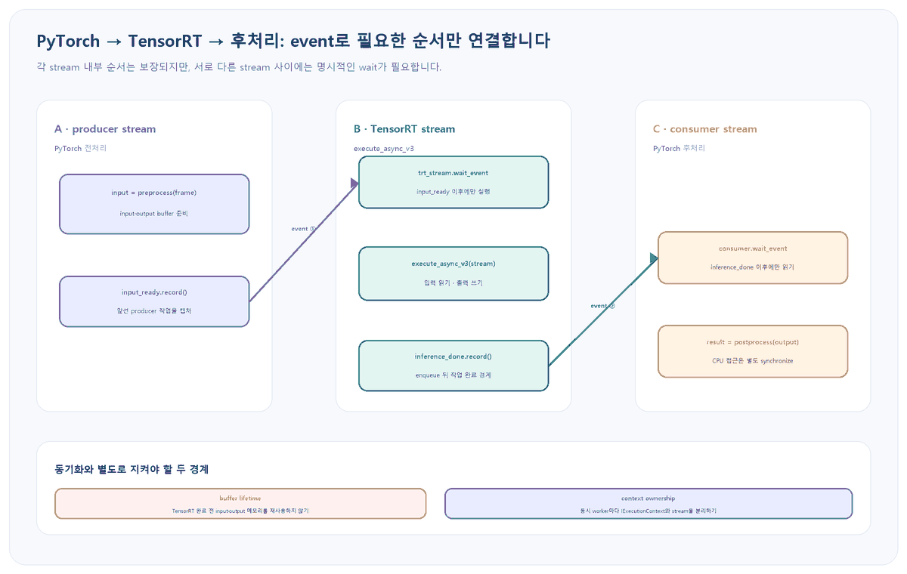

앞선 <a href="https://codersblog.github.io/posts/tensorrt-multi-gpu-context/" style="color:var(--link-color);font-weight:700;text-decoration:underline;">TensorRT 멀티 GPU 컨텍스트 진단 글</a>은 올바른 device와 CUDA context를 고르는 법을, <a href="https://codersblog.github.io/posts/tensorrt-engine-inference-verifier/" style="color:var(--link-color);font-weight:700;text-decoration:underline;">엔진 실추론 검증 글</a>은 한 번의 enqueue와 기준 출력 비교를 다뤘습니다. 두 글은 입력 준비와 출력 소비가 같은 실행 순서 안에 있다는 가정을 남겼습니다. 이번 글은 전처리와 TensorRT를 서로 다른 CUDA stream에 놓았을 때 그 가정이 깨지는 지점을 다룹니다.

대상 환경과 실패 증상

Linux 또는 Windows의 Python 서비스에서 PyTorch CUDA tensor를 전처리한 뒤 TensorRT 10/11의 <code style="padding:2px 6px;border-radius:5px;background:var(--card-bg);color:var(--text-color);font-family:Consolas,'Courier New',monospace;">execute_async_v3</code>에 device pointer로 전달한다고 가정합니다. 단일 요청은 통과하지만 동시 요청·연속 프레임에서 이전 프레임 결과가 섞이거나, 드물게 출력이 0·NaN이 되며, <code style="padding:2px 6px;border-radius:5px;background:var(--card-bg);color:var(--text-color);font-family:Consolas,'Courier New',monospace;">torch.cuda.synchronize()</code>를 넣으면 증상이 사라지는 상황입니다.

<figure style="margin:24px 0 30px;padding:14px;border:1px solid var(--main-border-color);border-radius:14px;background:var(--card-bg);">

<figcaption style="margin:10px 4px 0;color:var(--text-muted-color);font-size:13px;text-align:center;">그림 1. device 전체를 동기화하지 않고 producer→TensorRT→consumer 의존성만 event로 연결합니다. 실행 순서, 메모리 수명, context 소유권은 각각 별도로 지켜야 합니다.</figcaption>
</figure>

<h2 style="margin:34px 0 14px;padding-bottom:9px;border-bottom:2px solid var(--main-border-color);color:var(--heading-color);font-size:23px;">1. 먼저 stream race인지 진단 모드로 좁힙니다</h2>

CUDA 호출은 보통 CPU에 즉시 돌아오므로 오류가 실제 원인보다 늦은 API에서 보일 수 있습니다. 아래 두 실험은 원인을 좁히는 임시 진단이며 운영 설정이 아닙니다.

<pre style="margin:0 0 14px;padding:18px 20px;overflow:auto;border-radius:12px;background:var(--highlight-bg-color);color:var(--text-color);font-size:14px;line-height:1.55;"><code style="font-family:Consolas,'Courier New',monospace;"># PowerShell: 커널 launch를 동기화해 오류 위치를 좁힌다
$env:CUDA_LAUNCH_BLOCKING = '1'
python .\run_inference.py --requests 200 --workers 1
Remove-Item Env:CUDA_LAUNCH_BLOCKING

# 실제 서비스에서는 먼저 단일 worker와 동시 worker 결과를 분리한다
python .\run_inference.py --requests 200 --workers 8</code></pre>

<strong>기대 관찰값:</strong> launch blocking 또는 요청 경계의 device synchronize에서만 mismatch가 사라진다면 비동기 순서·수명 문제를 의심할 근거가 됩니다. 다만 동기화가 timing을 바꿔 context 공유 race까지 함께 가릴 수 있으므로 이것만으로 원인을 확정하지 않습니다.

<pre style="margin:0 0 14px;padding:18px 20px;overflow:auto;border-radius:12px;background:var(--highlight-bg-color);color:var(--text-color);font-size:14px;line-height:1.55;"><code style="font-family:Consolas,'Courier New',monospace;">def debug_snapshot(input_tensor, output_tensor, trt_stream):
    current = torch.cuda.current_stream(input_tensor.device)
    print({
        "device": input_tensor.device.index,
        "producer_stream": current.cuda_stream,
        "trt_stream": trt_stream.cuda_stream,
        "input_ptr": input_tensor.data_ptr(),
        "output_ptr": output_tensor.data_ptr(),
        "input_shape": tuple(input_tensor.shape),
        "output_shape": tuple(output_tensor.shape),
    })</code></pre>

<strong>진단 분기:</strong> device가 다르면 먼저 장치 매핑을 고칩니다. stream handle은 같은데도 실패하면 shape·binding·buffer 크기를 다시 확인합니다. 여러 요청이 같은 context와 같은 output pointer를 동시에 보이면 stream event보다 먼저 worker 소유권과 buffer pool을 분리합니다.

<h2 style="margin:34px 0 14px;padding-bottom:9px;border-bottom:2px solid var(--main-border-color);color:var(--heading-color);font-size:23px;">2. 정확성 기준선은 한 stream으로 만듭니다</h2>

가장 단순한 안전 기준선은 PyTorch 전처리, TensorRT enqueue, 출력 후처리를 같은 non-default stream에 넣는 것입니다. 같은 stream 안의 작업은 제출 순서대로 실행됩니다.

<pre style="margin:0 0 14px;padding:18px 20px;overflow:auto;border-radius:12px;background:var(--highlight-bg-color);color:var(--text-color);font-size:14px;line-height:1.55;"><code style="font-family:Consolas,'Courier New',monospace;">stream = torch.cuda.Stream(device=device)

with torch.cuda.stream(stream):
    input_tensor = preprocess(frame).contiguous()
    output_tensor = torch.empty(output_shape, device=device, dtype=torch.float32)

    context.set_input_shape(input_name, tuple(input_tensor.shape))
    context.set_tensor_address(input_name, input_tensor.data_ptr())
    context.set_tensor_address(output_name, output_tensor.data_ptr())
    if not context.execute_async_v3(stream_handle=stream.cuda_stream):
        raise RuntimeError("TensorRT enqueue failed")

# CPU가 결과를 읽거나 정확성 검사를 시작하기 전 완료를 보장한다
stream.synchronize()
result = postprocess(output_tensor)</code></pre>

<strong>기대 관찰값:</strong> 같은 입력의 기준 출력과 반복 출력이 허용 오차 안에서 일치하고 NaN이 없어야 합니다. 이 기준선도 실패하면 event를 추가하기 전에 engine profile, binding dtype·shape, output allocation을 고칩니다. 기준선은 안전하지만 CPU를 매 요청 멈추므로 최종 throughput 설계는 아닙니다.

<h2 style="margin:34px 0 14px;padding-bottom:9px;border-bottom:2px solid var(--main-border-color);color:var(--heading-color);font-size:23px;">3. producer에서 TensorRT로 event를 넘깁니다</h2>

전처리를 현재 PyTorch stream에 남기고 TensorRT 전용 stream을 쓴다면, producer가 입력을 다 쓴 시점을 event로 기록하고 TensorRT stream이 그 event를 기다리게 합니다. <code style="padding:2px 6px;border-radius:5px;background:var(--highlight-bg-color);color:var(--text-color);font-family:Consolas,'Courier New',monospace;">wait_event</code>는 CPU를 기다리게 하지 않고 이후 GPU 작업에 의존성만 추가합니다.

<pre style="margin:0 0 14px;padding:18px 20px;overflow:auto;border-radius:12px;background:var(--highlight-bg-color);color:var(--text-color);font-size:14px;line-height:1.55;"><code style="font-family:Consolas,'Courier New',monospace;">producer = torch.cuda.current_stream(device)
input_tensor = preprocess(frame).contiguous()
output_tensor = torch.empty(output_shape, device=device, dtype=torch.float32)

producer_done = torch.cuda.Event()
producer.record_event(producer_done)
trt_stream.wait_event(producer_done)

context.set_input_shape(input_name, tuple(input_tensor.shape))
context.set_tensor_address(input_name, input_tensor.data_ptr())
context.set_tensor_address(output_name, output_tensor.data_ptr())
if not context.execute_async_v3(stream_handle=trt_stream.cuda_stream):
    raise RuntimeError("TensorRT enqueue failed")</code></pre>

<strong>중요:</strong> event는 기록 호출 이전에 producer stream에 제출된 작업까지만 캡처합니다. 전처리보다 먼저 record하거나 다른 device의 event를 기다리면 의도한 순서가 만들어지지 않습니다. input과 output allocation도 producer_done 전에 끝내 두어 caching allocator의 이전 사용과 충돌하지 않게 합니다.

<h2 style="margin:34px 0 14px;padding-bottom:9px;border-bottom:2px solid var(--main-border-color);color:var(--heading-color);font-size:23px;">4. TensorRT에서 consumer로 완료 event를 넘깁니다</h2>

enqueue 함수가 성공했다고 GPU 계산이 끝난 것은 아닙니다. TensorRT stream에 완료 event를 기록하고, output을 읽을 stream이 그 event를 기다려야 합니다.

<pre style="margin:0 0 14px;padding:18px 20px;overflow:auto;border-radius:12px;background:var(--highlight-bg-color);color:var(--text-color);font-size:14px;line-height:1.55;"><code style="font-family:Consolas,'Courier New',monospace;">inference_done = torch.cuda.Event()
trt_stream.record_event(inference_done)

consumer = torch.cuda.current_stream(device)
consumer.wait_event(inference_done)

# 이후 consumer stream의 GPU 연산은 TensorRT 출력 완료 뒤 실행된다
result_gpu = postprocess_gpu(output_tensor)

# CPU가 값을 읽는 지점에서만 기다린다
consumer.synchronize()
result_cpu = result_gpu.cpu()</code></pre>

<strong>기대 관찰값:</strong> 즉시 <code style="padding:2px 6px;border-radius:5px;background:var(--highlight-bg-color);color:var(--text-color);font-family:Consolas,'Courier New',monospace;">inference_done.query()</code>가 false여도 정상입니다. 중요한 것은 consumer에 이후 제출되는 후처리가 event 뒤로 정렬되는 것입니다. CPU가 tensor 값을 읽거나 비동기 D2H 복사 결과를 사용할 때는 해당 stream 또는 copy event를 별도로 동기화합니다.

<h2 style="margin:34px 0 14px;padding-bottom:9px;border-bottom:2px solid var(--main-border-color);color:var(--heading-color);font-size:23px;">5. record_stream은 수명 관리이지 순서 보장이 아닙니다</h2>

PyTorch caching allocator는 tensor가 만들어진 stream은 알지만 다른 stream의 사용을 자동으로 알지 못합니다. TensorRT stream이 input과 output pointer를 사용하는 동안 메모리가 다른 tensor에 재사용되지 않게 참조를 유지하거나 <code style="padding:2px 6px;border-radius:5px;background:var(--highlight-bg-color);color:var(--text-color);font-family:Consolas,'Courier New',monospace;">record_stream</code>으로 allocator에 사용 stream을 알립니다.

<pre style="margin:0 0 14px;padding:18px 20px;overflow:auto;border-radius:12px;background:var(--highlight-bg-color);color:var(--text-color);font-size:14px;line-height:1.55;"><code style="font-family:Consolas,'Courier New',monospace;"># allocator가 TensorRT stream 작업 완료 전 메모리를 재사용하지 않게 한다
input_tensor.record_stream(trt_stream)
output_tensor.record_stream(trt_stream)

# 이 호출만으로 producer → TensorRT 또는 TensorRT → consumer 순서는 생기지 않는다
# 순서는 producer_done / inference_done event와 wait_event로 별도 보장한다</code></pre>

<strong>선택 기준:</strong> library 경계에서 tensor 참조 수명을 통제하기 어렵다면 record_stream이 실용적입니다. adapter가 모든 in-flight 요청을 소유한다면 input·output·event를 완료까지 보관하고, creation stream이 consumer 완료 event를 기다린 뒤 참조를 해제하는 방식이 메모리 사용 시점을 더 예측하기 쉽습니다.

<h2 style="margin:34px 0 14px;padding-bottom:9px;border-bottom:2px solid var(--main-border-color);color:var(--heading-color);font-size:23px;">6. 동시 요청은 context와 buffer까지 분리합니다</h2>

event가 올바르더라도 하나의 <code style="padding:2px 6px;border-radius:5px;background:var(--highlight-bg-color);color:var(--text-color);font-family:Consolas,'Courier New',monospace;">IExecutionContext</code>를 여러 thread가 동시에 수정·enqueue하면 안전하지 않습니다. 공유 가능한 engine에서 worker별 context를 만들고 각 context에 전용 stream과 I/O buffer를 붙입니다.

<pre style="margin:0 0 14px;padding:18px 20px;overflow:auto;border-radius:12px;background:var(--highlight-bg-color);color:var(--text-color);font-size:14px;line-height:1.55;"><code style="font-family:Consolas,'Courier New',monospace;">class Worker:
    def __init__(self, engine, device):
        self.device = torch.device(device)
        self.context = engine.create_execution_context()
        self.stream = torch.cuda.Stream(device=self.device)
        if self.context is None:
            raise RuntimeError("failed to create IExecutionContext")

# worker마다 context·stream·buffer pool을 하나씩 소유한다
workers = [Worker(engine, "cuda:0") for _ in range(concurrency)]</code></pre>

<strong>동적 shape 주의:</strong> 동시 context가 dynamic shape engine을 쓴다면 사용 중인 optimization profile을 context별로 분리하는 제약도 확인합니다. 단순히 Python lock으로 <code style="padding:2px 6px;border-radius:5px;background:var(--highlight-bg-color);color:var(--text-color);font-family:Consolas,'Courier New',monospace;">set_input_shape</code>만 감싼 뒤 GPU 작업 완료 전에 lock을 풀면 context 수명 경계를 완전히 해결했다고 볼 수 없습니다.

<table style="width:100%;margin:0 0 24px;border-collapse:collapse;border:1px solid var(--main-border-color);background:var(--card-bg);font-size:14px;">
<thead style="background:var(--highlight-bg-color);"><tr style="border-bottom:1px solid var(--main-border-color);"><th style="padding:11px 12px;border-right:1px solid var(--main-border-color);text-align:left;color:var(--heading-color);">경계</th><th style="padding:11px 12px;border-right:1px solid var(--main-border-color);text-align:left;color:var(--heading-color);">보장 수단</th><th style="padding:11px 12px;text-align:left;color:var(--heading-color);">해결하지 못하는 것</th></tr></thead>
<tbody style="color:var(--text-color);">
<tr style="border-bottom:1px solid var(--main-border-color);"><td style="padding:10px 12px;border-right:1px solid var(--main-border-color);">producer → TensorRT</td><td style="padding:10px 12px;border-right:1px solid var(--main-border-color);">producer event + trt wait</td><td style="padding:10px 12px;">메모리 조기 재사용</td></tr>
<tr style="border-bottom:1px solid var(--main-border-color);"><td style="padding:10px 12px;border-right:1px solid var(--main-border-color);">TensorRT → consumer</td><td style="padding:10px 12px;border-right:1px solid var(--main-border-color);">done event + consumer wait</td><td style="padding:10px 12px;">CPU의 조기 접근</td></tr>
<tr style="border-bottom:1px solid var(--main-border-color);"><td style="padding:10px 12px;border-right:1px solid var(--main-border-color);">tensor 수명</td><td style="padding:10px 12px;border-right:1px solid var(--main-border-color);">참조 유지 또는 record_stream</td><td style="padding:10px 12px;">stream 실행 순서</td></tr>
<tr><td style="padding:10px 12px;border-right:1px solid var(--main-border-color);">동시 worker</td><td style="padding:10px 12px;border-right:1px solid var(--main-border-color);">context·stream·buffer 분리</td><td style="padding:10px 12px;">잘못된 shape·dtype</td></tr>
</tbody></table>

<h2 style="margin:34px 0 14px;padding-bottom:9px;border-bottom:2px solid var(--main-border-color);color:var(--heading-color);font-size:23px;">7. 결과와 성능을 함께 검증합니다</h2>
<pre style="margin:0 0 14px;padding:18px 20px;overflow:auto;border-radius:12px;background:var(--highlight-bg-color);color:var(--text-color);font-size:14px;line-height:1.55;"><code style="font-family:Consolas,'Courier New',monospace;">torch.testing.assert_close(
    async_output,
    single_stream_reference,
    rtol=1e-3,
    atol=1e-4,
    equal_nan=False,
)
assert torch.isfinite(async_output).all()

start = torch.cuda.Event(enable_timing=True)
end = torch.cuda.Event(enable_timing=True)
start.record(trt_stream)
context.execute_async_v3(stream_handle=trt_stream.cuda_stream)
end.record(trt_stream)
end.synchronize()
print("TensorRT GPU ms:", start.elapsed_time(end))</code></pre>

<strong>검증 순서:</strong> 고정 입력 반복, 서로 다른 입력 교차, 동시 요청, 장시간 soak 순으로 mismatch·NaN·pointer 재사용을 확인합니다. event timing은 GPU 구간을 재는 값이므로 end-to-end latency와 함께 기록합니다.

<h3 style="margin:30px 0 12px;color:var(--heading-color);font-size:19px;">이 초안의 검증 경계</h3>

공식 TensorRT·CUDA·PyTorch 문서에서 API 계약과 stream·event·allocator 경계를 대조했고, HTML 안 Python 예시는 구문 검사를 통과하도록 작성했습니다. 이 Windows 작성 환경에서는 실제 TensorRT engine과 NVIDIA GPU로 출력 parity·동시성·latency를 실행하지 않았습니다. 배포 전에 대상 engine, 실제 shape profile, 실제 worker 수로 위 검증을 수행해야 합니다.

<h2 style="margin:34px 0 14px;padding-bottom:9px;border-bottom:2px solid var(--main-border-color);color:var(--heading-color);font-size:23px;">롤백과 중단 기준</h2>
<ul style="margin:0 0 24px;padding-left:24px;color:var(--text-color);">
<li style="margin:8px 0;">event 적용 뒤 mismatch가 하나라도 남으면 비동기 최적화를 중단하고 한 stream + <code style="padding:2px 6px;border-radius:5px;background:var(--highlight-bg-color);color:var(--text-color);font-family:Consolas,'Courier New',monospace;">stream.synchronize()</code> 기준선으로 복귀합니다.</li>
<li style="margin:8px 0;">context·buffer 소유자가 불명확하면 concurrency를 1로 낮춘 뒤 worker별 자원을 분리합니다.</li>
<li style="margin:8px 0;">CPU가 output을 읽는 지점이 여러 곳이면 먼저 하나의 명시적 소비 지점으로 모읍니다.</li>
<li style="margin:8px 0;">record_stream을 제거할 때는 완료 event까지 참조를 보관하는 대체 수명 규칙을 먼저 구현합니다.</li>
<li style="margin:8px 0;">성능 개선보다 정확성 parity와 장시간 안정성 검증을 배포 gate로 둡니다.</li>
</ul>

<h2 style="margin:34px 0 14px;padding-bottom:9px;border-bottom:2px solid var(--main-border-color);color:var(--heading-color);font-size:23px;">공식 출처</h2>
<ul style="margin:0 0 26px;padding-left:24px;color:var(--text-color);">
<li style="margin:8px 0;"><a href="https://docs.nvidia.com/deeplearning/tensorrt/latest/inference-library/python-api-docs.html" style="color:var(--link-color);text-decoration:underline;">NVIDIA TensorRT Python API: execute_async_v3와 CUDA 동기화</a></li>
<li style="margin:8px 0;"><a href="https://docs.nvidia.com/deeplearning/tensorrt/latest/architecture/how-trt-works.html" style="color:var(--link-color);text-decoration:underline;">NVIDIA TensorRT 아키텍처: thread safety와 execution context 소유권</a></li>
<li style="margin:8px 0;"><a href="https://docs.nvidia.com/deeplearning/tensorrt/latest/_static/c-api/classnvinfer1_1_1_i_execution_context.html" style="color:var(--link-color);text-decoration:underline;">NVIDIA IExecutionContext API: enqueue, buffer 수명, auxiliary stream 동기화</a></li>
<li style="margin:8px 0;"><a href="https://docs.nvidia.com/cuda/cuda-runtime-api/cuda_runtime_api/group__CUDART__EVENT.html" style="color:var(--link-color);text-decoration:underline;">NVIDIA CUDA Runtime Event API: event record·query·synchronize·stream wait</a></li>
<li style="margin:8px 0;"><a href="https://docs.pytorch.org/docs/main/notes/cuda.html" style="color:var(--link-color);text-decoration:underline;">PyTorch CUDA semantics: non-default stream 동기화와 lifetime</a></li>
<li style="margin:8px 0;"><a href="https://docs.pytorch.org/docs/main/generated/torch.cuda.Stream_class.html" style="color:var(--link-color);text-decoration:underline;">PyTorch Stream API: record_event, wait_event, wait_stream, synchronize</a></li>
<li style="margin:8px 0;"><a href="https://docs.pytorch.org/docs/stable/generated/torch.Tensor.record_stream.html" style="color:var(--link-color);text-decoration:underline;">PyTorch Tensor.record_stream: caching allocator 수명 계약</a></li>
</ul>

