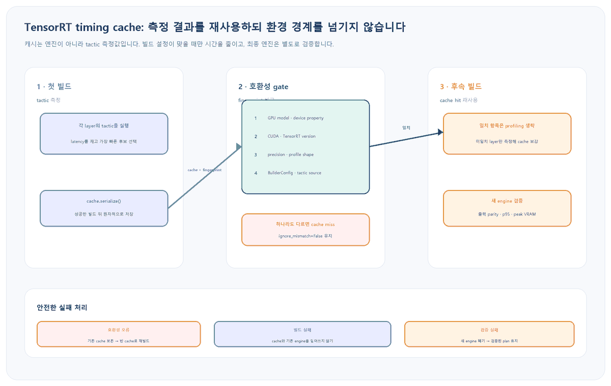

앞선 <a href="https://codersblog.github.io/posts/tensorrt-dynamic-shape-profiles/" style="color:var(--link-color);font-weight:700;text-decoration:underline;">Dynamic Shape Profile 글</a>은 입력 분포에 맞춰 min·opt·max를 정하는 법을 다뤘지만, profile이나 정밀도 조합마다 엔진을 다시 만들 때 늘어나는 빌드 시간은 다루지 않았습니다. 이번 글은 같은 계열 모델을 CI와 배포 노드에서 반복 빌드할 때, TensorRT의 tactic 측정 결과만 재사용하고 최종 엔진 검증은 생략하지 않는 운영 절차를 설명합니다.

대상 환경과 실패 증상

Linux 또는 Windows에서 TensorRT 10/11과 <code style="padding:2px 6px;border-radius:5px;background:var(--card-bg);color:var(--text-color);font-family:Consolas,'Courier New',monospace;">trtexec</code> 또는 Python Builder API로 ONNX 엔진을 반복 생성한다고 가정합니다. 같은 모델과 shape인데도 배포마다 layer tactic profiling이 다시 실행되어 빌드가 수십 분 걸리고, CI timeout이나 GPU 점유 충돌이 발생하는 상황입니다.

<figure style="margin:24px 0 30px;padding:14px;border:1px solid var(--main-border-color);border-radius:14px;background:var(--card-bg);">

<figcaption style="margin:10px 4px 0;color:var(--text-muted-color);font-size:13px;text-align:center;">그림 1. timing cache는 tactic 측정 결과이며 엔진 자체가 아닙니다. 호환성 gate, 원자적 저장, 새 엔진 검증을 각각 통과해야 배포 시간을 안전하게 줄일 수 있습니다.</figcaption>
</figure>

<h2 style="margin:34px 0 14px;padding-bottom:9px;border-bottom:2px solid var(--main-border-color);color:var(--heading-color);font-size:23px;">1. cache를 넣기 전에 빌드 기준선을 남깁니다</h2>

먼저 cache가 없는 상태에서 모델 hash, TensorRT 버전, GPU, BuilderConfig와 wall-clock 빌드 시간을 한 묶음으로 기록합니다. cache 효과와 설정 변경 효과를 섞지 않기 위한 기준선입니다.

<pre style="margin:0 0 14px;padding:18px 20px;overflow:auto;border-radius:12px;background:var(--highlight-bg-color);color:var(--text-color);font-size:14px;line-height:1.55;"><code style="font-family:Consolas,'Courier New',monospace;"># PowerShell: 환경과 입력 모델을 식별한다
Get-FileHash .\model.onnx -Algorithm SHA256
python -c "import tensorrt as trt; print(trt.__version__)"
nvidia-smi --query-gpu=name,uuid,driver_version --format=csv,noheader

# 같은 shape·precision으로 cache 없는 기준 엔진을 만든다
Measure-Command { trtexec --onnx=model.onnx --saveEngine=baseline.plan --fp16 --minShapes=images:1x3x640x640 --optShapes=images:4x3x640x640 --maxShapes=images:8x3x640x640 --verbose }</code></pre>

<strong>기대 관찰값:</strong> 로그에 각 layer 후보 tactic의 timing과 선택 과정이 나타나고, 첫 빌드 시간이 기준값이 됩니다. 같은 ONNX라도 opt shape, FP16·TF32·INT8, workspace, tactic source가 달라지면 다른 빌드 계약이므로 fingerprint를 따로 관리합니다.

<h2 style="margin:34px 0 14px;padding-bottom:9px;border-bottom:2px solid var(--main-border-color);color:var(--heading-color);font-size:23px;">2. trtexec로 cold build와 warm build를 분리합니다</h2>

<code style="padding:2px 6px;border-radius:5px;background:var(--highlight-bg-color);color:var(--text-color);font-family:Consolas,'Courier New',monospace;">--timingCacheFile</code>을 지정하면 첫 빌드는 cache miss를 측정해 파일을 채우고, 다음 빌드는 일치하는 항목의 profiling을 재사용합니다. cache 경로는 GPU·TensorRT·정밀도·profile을 구분하도록 이름을 붙입니다.

<pre style="margin:0 0 14px;padding:18px 20px;overflow:auto;border-radius:12px;background:var(--highlight-bg-color);color:var(--text-color);font-size:14px;line-height:1.55;"><code style="font-family:Consolas,'Courier New',monospace;"># 첫 실행: 빈 cache를 만들고 측정 결과를 기록한다
trtexec --onnx=model.onnx --saveEngine=cold.plan --fp16 --minShapes=images:1x3x640x640 --optShapes=images:4x3x640x640 --maxShapes=images:8x3x640x640 --timingCacheFile=cache\trt11.4-rtx4090-fp16-640.bin --verbose

# 두 번째 실행: 같은 계약으로 timing cache를 재사용한다
trtexec --onnx=model.onnx --saveEngine=warm.plan --fp16 --minShapes=images:1x3x640x640 --optShapes=images:4x3x640x640 --maxShapes=images:8x3x640x640 --timingCacheFile=cache\trt11.4-rtx4090-fp16-640.bin --verbose</code></pre>

<strong>기대 관찰값:</strong> warm build의 tactic profiling 횟수와 wall-clock 시간이 줄어듭니다. 변화가 거의 없으면 cache 경로 권한, cache 크기 증가 여부, layer I/O 구성의 일치 여부를 확인합니다. timing cache가 모든 layer와 plugin을 반드시 포괄하는 것은 아니므로 일부 profiling이 남는 것은 실패가 아닙니다.

<h2 style="margin:34px 0 14px;padding-bottom:9px;border-bottom:2px solid var(--main-border-color);color:var(--heading-color);font-size:23px;">3. Python API에서는 strict attach와 원자적 저장을 사용합니다</h2>

서비스용 빌더에서는 cache 파일이 없으면 빈 cache를 만들고, 있으면 읽은 뒤 <code style="padding:2px 6px;border-radius:5px;background:var(--highlight-bg-color);color:var(--text-color);font-family:Consolas,'Courier New',monospace;">ignore_mismatch=False</code>로 붙입니다. 빌드가 성공한 뒤에만 임시 파일을 최종 cache 경로로 교체해야 중단된 빌드가 정상 cache를 손상시키지 않습니다.

<pre style="margin:0 0 14px;padding:18px 20px;overflow:auto;border-radius:12px;background:var(--highlight-bg-color);color:var(--text-color);font-size:14px;line-height:1.55;"><code style="font-family:Consolas,'Courier New',monospace;">from pathlib import Path
import os
import tensorrt as trt

def build_with_timing_cache(builder, network, config, cache_path):
    cache_path = Path(cache_path)
    cache_bytes = cache_path.read_bytes() if cache_path.exists() else b""
    timing_cache = config.create_timing_cache(cache_bytes)

    if not config.set_timing_cache(timing_cache, ignore_mismatch=False):
        raise RuntimeError("timing cache is incompatible with this build environment")

    plan = builder.build_serialized_network(network, config)
    if plan is None:
        raise RuntimeError("engine build failed; existing cache was preserved")

    updated = bytes(timing_cache.serialize())
    cache_path.parent.mkdir(parents=True, exist_ok=True)
    temporary = cache_path.with_suffix(cache_path.suffix + ".tmp")
    temporary.write_bytes(updated)
    os.replace(temporary, cache_path)
    return bytes(plan)</code></pre>

<strong>진단 분기:</strong> strict attach가 실패하면 기존 파일을 덮어쓰거나 <code style="padding:2px 6px;border-radius:5px;background:var(--highlight-bg-color);color:var(--text-color);font-family:Consolas,'Courier New',monospace;">ignore_mismatch=True</code>로 우회하지 않습니다. 이전 cache를 보존하고 새 fingerprint 경로에서 빈 cache로 빌드합니다. NVIDIA는 다른 device property의 cache를 강제 사용하면 기능 또는 성능 문제가 생길 수 있다고 경고합니다.

<h2 style="margin:34px 0 14px;padding-bottom:9px;border-bottom:2px solid var(--main-border-color);color:var(--heading-color);font-size:23px;">4. cache key를 파일명보다 강한 manifest로 고정합니다</h2>

파일명은 사람이 읽기 위한 표시일 뿐입니다. 실제 재사용 gate에는 모델 SHA-256과 아래 값을 JSON manifest로 저장하고 완전 일치 여부를 검사합니다.

<table style="width:100%;margin:0 0 18px;border-collapse:collapse;border:1px solid var(--main-border-color);background:var(--card-bg);font-size:14px;">
<thead style="background:var(--highlight-bg-color);"><tr style="border-bottom:1px solid var(--main-border-color);"><th style="padding:11px 12px;border-right:1px solid var(--main-border-color);text-align:left;color:var(--heading-color);">경계</th><th style="padding:11px 12px;border-right:1px solid var(--main-border-color);text-align:left;color:var(--heading-color);">기록값</th><th style="padding:11px 12px;text-align:left;color:var(--heading-color);">달라졌을 때</th></tr></thead>
<tbody style="color:var(--text-color);">
<tr style="border-bottom:1px solid var(--main-border-color);"><td style="padding:10px 12px;border-right:1px solid var(--main-border-color);">하드웨어</td><td style="padding:10px 12px;border-right:1px solid var(--main-border-color);">GPU model·UUID 또는 device property</td><td style="padding:10px 12px;">새 cache</td></tr>
<tr style="border-bottom:1px solid var(--main-border-color);"><td style="padding:10px 12px;border-right:1px solid var(--main-border-color);">소프트웨어</td><td style="padding:10px 12px;border-right:1px solid var(--main-border-color);">TensorRT·CUDA·driver·plugin version</td><td style="padding:10px 12px;">새 cache</td></tr>
<tr style="border-bottom:1px solid var(--main-border-color);"><td style="padding:10px 12px;border-right:1px solid var(--main-border-color);">네트워크</td><td style="padding:10px 12px;border-right:1px solid var(--main-border-color);">ONNX hash·input dtype·profile shapes</td><td style="padding:10px 12px;">새 namespace 권장</td></tr>
<tr><td style="padding:10px 12px;border-right:1px solid var(--main-border-color);">BuilderConfig</td><td style="padding:10px 12px;border-right:1px solid var(--main-border-color);">precision flags·workspace·tactic sources·optimization level</td><td style="padding:10px 12px;">동일 계약으로 다시 측정</td></tr>
</tbody></table>
<pre style="margin:0 0 14px;padding:18px 20px;overflow:auto;border-radius:12px;background:var(--highlight-bg-color);color:var(--text-color);font-size:14px;line-height:1.55;"><code style="font-family:Consolas,'Courier New',monospace;">{
  "model_sha256": "9bd4...",
  "tensorrt": "11.4.1",
  "cuda": "13.1",
  "gpu": "NVIDIA GeForce RTX 4090",
  "precision": ["FP16"],
  "profile": {"images": [[1,3,640,640], [4,3,640,640], [8,3,640,640]]},
  "builder_optimization_level": 3
}</code></pre>

<strong>운영 기준:</strong> 여러 CI job이 같은 cache 파일을 동시에 갱신하지 않게 lock을 두거나 job별 파일을 만든 뒤, 동일한 TensorRT 버전과 device property에서 생성된 cache만 merge합니다. 서로 다른 GPU cache를 강제로 합치는 방식은 사용하지 않습니다.

<h2 style="margin:34px 0 14px;padding-bottom:9px;border-bottom:2px solid var(--main-border-color);color:var(--heading-color);font-size:23px;">5. cache miss를 배포 gate로 관찰합니다</h2>

warm cache가 충분히 채워졌다고 판단한 뒤에는 지원되는 TensorRT 버전에서 timing cache miss를 오류로 바꾸어, 예상하지 못한 네트워크나 설정 변경을 CI에서 드러낼 수 있습니다. 첫 빌드부터 이 flag를 켜면 정상적인 cache 채우기도 막히므로 warm-up 단계와 검증 단계를 분리합니다.

<pre style="margin:0 0 14px;padding:18px 20px;overflow:auto;border-radius:12px;background:var(--highlight-bg-color);color:var(--text-color);font-size:14px;line-height:1.55;"><code style="font-family:Consolas,'Courier New',monospace;"># cache를 충분히 채운 뒤 검증 job에서만 사용한다
config.set_flag(trt.BuilderFlag.ERROR_ON_TIMING_CACHE_MISS)

# 빌드 실패 시 모델·profile·precision·plugin 변경 여부를 먼저 비교한다
plan = builder.build_serialized_network(network, config)
if plan is None:
    raise RuntimeError("unexpected timing cache miss or engine build failure")</code></pre>

<strong>기대 관찰값:</strong> 동일 계약의 검증 빌드는 miss 없이 통과합니다. miss가 생기면 cache를 무조건 정답으로 취급하지 말고 변경이 의도된 것인지 확인한 뒤 새 cache를 채웁니다. 이 flag가 설치 버전에 없다면 API 존재 여부를 확인하고 일반 verbose log의 profiling 항목을 비교합니다.

<h2 style="margin:34px 0 14px;padding-bottom:9px;border-bottom:2px solid var(--main-border-color);color:var(--heading-color);font-size:23px;">6. 빨리 만들어진 엔진도 출력과 성능을 다시 검증합니다</h2>

timing cache hit는 빌드 시간을 줄였다는 뜻이지 새 plan이 서비스 기준을 통과했다는 뜻이 아닙니다. 앞선 <a href="https://codersblog.github.io/posts/tensorrt-engine-inference-verifier/" style="color:var(--link-color);font-weight:700;text-decoration:underline;">엔진 실추론 검증 글</a>의 golden output 검사를 실행하고, baseline과 warm plan을 같은 조건에서 비교합니다.

<pre style="margin:0 0 14px;padding:18px 20px;overflow:auto;border-radius:12px;background:var(--highlight-bg-color);color:var(--text-color);font-size:14px;line-height:1.55;"><code style="font-family:Consolas,'Courier New',monospace;">trtexec --loadEngine=warm.plan --shapes=images:4x3x640x640 --warmUp=1000 --duration=60 --useCudaGraph
python .\verify_engine.py --engine .\warm.plan --golden .\golden.npz --rtol 1e-3 --atol 1e-4
Get-FileHash .\cache\trt11.4-rtx4090-fp16-640.bin -Algorithm SHA256</code></pre>

<strong>배포 gate:</strong> 출력에 NaN·Inf가 없고 golden output과 허용 오차 안에서 일치해야 합니다. p95 latency와 peak VRAM이 기존 검증된 plan의 허용 범위를 벗어나면 cache 재사용 여부와 관계없이 배포하지 않습니다.

<h3 style="margin:30px 0 12px;color:var(--heading-color);font-size:19px;">이 초안의 검증 경계</h3>

현재 NVIDIA TensorRT 문서에서 timing cache 생성·attach·serialize, strict mismatch, compilation cache, builder optimization level, determinism 계약을 대조했고 Python 예시는 구문 검사 대상으로 구성했습니다. 이 Windows 작성 환경에는 TensorRT와 NVIDIA GPU가 연결되어 있지 않아 실제 cold/warm 빌드 시간, cache hit 수, 출력 parity를 실행하지 않았습니다. 배포 GPU에서 같은 ONNX·profile·precision으로 측정해야 합니다.

<h2 style="margin:34px 0 14px;padding-bottom:9px;border-bottom:2px solid var(--main-border-color);color:var(--heading-color);font-size:23px;">롤백과 중단 기준</h2>
<ul style="margin:0 0 24px;padding-left:24px;color:var(--text-color);">
<li style="margin:8px 0;">cache attach mismatch가 나오면 강제 로드를 중단하고 새 fingerprint 경로에서 빈 cache로 재빌드합니다.</li>
<li style="margin:8px 0;">빌드가 실패하면 기존 cache와 기존 검증 엔진을 덮어쓰지 않습니다.</li>
<li style="margin:8px 0;">warm plan의 golden output, p95 latency, peak VRAM 중 하나라도 기준을 벗어나면 새 plan을 폐기합니다.</li>
<li style="margin:8px 0;">문제 분리가 필요하면 timing cache 파일을 제거하거나 새 경로를 지정해 cold build로 복귀합니다. cache 삭제는 기존 plan을 삭제하지 않습니다.</li>
<li style="margin:8px 0;">빌드 시간을 더 줄이려고 builder optimization level을 낮췄다면 cache 효과와 별개 변경으로 기록하고 추론 성능을 다시 비교합니다.</li>
</ul>

<h2 style="margin:34px 0 14px;padding-bottom:9px;border-bottom:2px solid var(--main-border-color);color:var(--heading-color);font-size:23px;">공식 출처</h2>
<ul style="margin:0 0 26px;padding-left:24px;color:var(--text-color);">
<li style="margin:8px 0;"><a href="https://docs.nvidia.com/deeplearning/tensorrt/10.x.x/performance/builder-performance.html" style="color:var(--link-color);text-decoration:underline;">NVIDIA TensorRT: Optimizing Builder Performance — Timing Cache</a></li>
<li style="margin:8px 0;"><a href="https://docs.nvidia.com/deeplearning/tensorrt/10.x.x/performance/optimization.html" style="color:var(--link-color);text-decoration:underline;">NVIDIA TensorRT: Optimizing Performance — tactic timing과 determinism</a></li>
<li style="margin:8px 0;"><a href="https://docs.nvidia.com/deeplearning/tensorrt/latest/_static/python-api/infer/Core/BuilderConfig.html" style="color:var(--link-color);text-decoration:underline;">NVIDIA TensorRT Python API: IBuilderConfig timing cache와 flags</a></li>
<li style="margin:8px 0;"><a href="https://docs.nvidia.com/deeplearning/tensorrt/latest/_static/c-api/classnvinfer1_1_1_i_builder_config.html" style="color:var(--link-color);text-decoration:underline;">NVIDIA IBuilderConfig API: setTimingCache와 mismatch 경고</a></li>
<li style="margin:8px 0;"><a href="https://docs.nvidia.com/deeplearning/tensorrt/latest/_static/c-api/classnvinfer1_1_1_i_timing_cache.html" style="color:var(--link-color);text-decoration:underline;">NVIDIA ITimingCache API: serialize·combine·reset</a></li>
<li style="margin:8px 0;"><a href="https://docs.nvidia.com/deeplearning/tensorrt/latest/inference-library/capabilities.html" style="color:var(--link-color);text-decoration:underline;">NVIDIA TensorRT Capabilities: trtexec와 serialized timing cache</a></li>
</ul>

