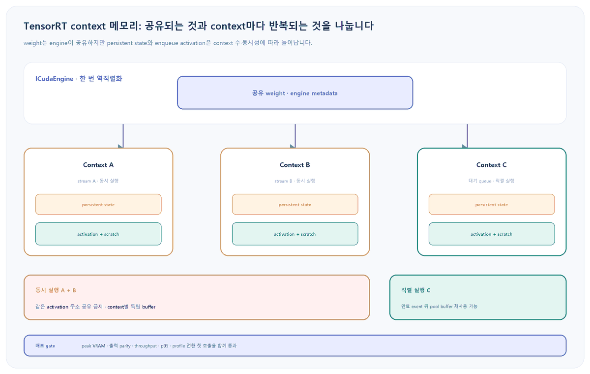

앞선 <a href="https://codersblog.github.io/posts/tensorrt-pytorch-cuda-stream-sync/" style="color:var(--link-color);font-weight:700;text-decoration:underline;">CUDA stream 동기화 글</a>은 worker마다 execution context와 buffer를 분리해야 race를 막을 수 있다고 설명했습니다. 또한 <a href="https://codersblog.github.io/posts/tensorrt-data-dependent-output-allocator/" style="color:var(--link-color);font-weight:700;text-decoration:underline;">데이터 의존 출력 버퍼 글</a>은 output 크기의 상한과 재할당을 다뤘습니다. 두 글의 한계는 context 수를 늘릴 때 중간 activation·scratch·persistent memory가 얼마나 반복되는지, 그리고 동시 실행하지 않는 context끼리 enqueue memory를 어떻게 안전하게 공유할지 다루지 않았다는 점입니다. worker를 늘린 직후 OOM이 난다면 지금 이 다음 단계가 필요합니다.

대상 환경과 실패 증상

Linux 또는 Windows의 NVIDIA dGPU에서 TensorRT 11.4 계열, dynamic shape engine, <code style="padding:2px 6px;border-radius:5px;background:var(--card-bg);color:var(--text-color);font-family:Consolas,'Courier New',monospace;">enqueueV3()</code> 또는 <code style="padding:2px 6px;border-radius:5px;background:var(--card-bg);color:var(--text-color);font-family:Consolas,'Courier New',monospace;">execute_async_v3()</code>를 사용한다고 가정합니다. context 하나는 정상인데 worker를 2~4개로 늘리면 engine을 다시 읽지 않았어도 VRAM이 크게 증가하거나 context 생성·첫 추론에서 OOM이 발생하는 상황입니다. 목표는 무조건 context 수를 줄이는 것이 아니라 동시성 요구와 메모리 상한을 함께 만족하는 것입니다.

<figure style="margin:24px 0 30px;padding:14px;border:1px solid var(--main-border-color);border-radius:14px;background:var(--card-bg);">

<figcaption style="margin:10px 4px 0;color:var(--text-muted-color);font-size:13px;text-align:center;">그림 1. engine weight가 한 번만 올라가도 context별 상태와 enqueue memory는 반복됩니다. 한 buffer 공유는 겹치지 않는 실행에만 허용합니다.</figcaption>
</figure>

<h2 style="margin:34px 0 14px;padding-bottom:9px;border-bottom:2px solid var(--main-border-color);color:var(--heading-color);font-size:23px;">1. 먼저 weight와 context memory를 따로 셉니다</h2>

engine을 역직렬화하면 weight가 device memory에 올라갑니다. 각 execution context는 layer 상태용 persistent memory와 추론 중간값·임시 작업 공간을 담는 enqueue memory를 추가로 사용합니다. 따라서 plan 파일 크기만 보고 worker 수를 곱하면 실제 VRAM을 예측할 수 없습니다.

<pre style="margin:0 0 14px;padding:18px 20px;overflow:auto;border-radius:12px;background:var(--highlight-bg-color);color:var(--text-color);font-size:14px;line-height:1.55;"><code style="font-family:Consolas,'Courier New',monospace;">python3 -c "import tensorrt as trt; print(trt.__version__)"
trtexec --help | grep -E 'allocationStrategy|runtimeActivationResize|infStreams'
nvidia-smi --query-gpu=name,uuid,driver_version,memory.total,memory.used --format=csv</code></pre>

<strong>기대 관찰값:</strong> 실제 설치가 TensorRT 11.x인지, CLI가 세 allocation 전략과 runtime resize preview를 지원하는지, 다른 process가 이미 VRAM을 쓰고 있는지 확인됩니다. pip wheel만 설치한 환경에는 <code style="padding:2px 6px;border-radius:5px;background:var(--highlight-bg-color);color:var(--text-color);font-family:Consolas,'Courier New',monospace;">trtexec</code>가 없을 수 있으므로 Python API 경로를 사용합니다.

<code style="padding:2px 6px;border-radius:5px;background:var(--highlight-bg-color);color:var(--text-color);font-family:Consolas,'Courier New',monospace;">trtexec --monitorMemory</code>는 build phase의 host·device 사용량을 보는 flag입니다. 이미 만든 plan의 runtime context 메모리 상한으로 오해하지 않습니다.

<h3 style="margin:30px 0 12px;color:var(--heading-color);font-size:19px;">engine이 보고하는 상한을 기록합니다</h3>
<pre style="margin:0 0 14px;padding:18px 20px;overflow:auto;border-radius:12px;background:var(--highlight-bg-color);color:var(--text-color);font-size:14px;line-height:1.55;"><code style="font-family:Consolas,'Courier New',monospace;">import tensorrt as trt

logger = trt.Logger(trt.Logger.INFO)
runtime = trt.Runtime(logger)
with open("model.plan", "rb") as file:
    engine = runtime.deserialize_cuda_engine(file.read())
if engine is None:
    raise RuntimeError("engine deserialization failed")

print("all_profiles_bytes=", engine.device_memory_size_v2)
for profile_index in range(engine.num_optimization_profiles):
    size = engine.get_device_memory_size_for_profile_v2(profile_index)
    print(f"profile={profile_index} bytes={size}")</code></pre>

<strong>해석:</strong> <code style="padding:2px 6px;border-radius:5px;background:var(--highlight-bg-color);color:var(--text-color);font-family:Consolas,'Courier New',monospace;">device_memory_size_v2</code>는 execution context의 enqueue memory 상한입니다. 실제 process 증가는 CUDA context·TensorRT device code·context persistent memory·plugin 내부 할당까지 포함하므로 이 값과 정확히 같지 않습니다. 여러 process가 같은 GPU에서 동시에 변하면 <code style="padding:2px 6px;border-radius:5px;background:var(--highlight-bg-color);color:var(--text-color);font-family:Consolas,'Courier New',monospace;">cudaMemGetInfo</code>와 <code style="padding:2px 6px;border-radius:5px;background:var(--highlight-bg-color);color:var(--text-color);font-family:Consolas,'Courier New',monospace;">nvidia-smi</code> 차이는 즉시 낡을 수 있습니다.

<h2 style="margin:34px 0 14px;padding-bottom:9px;border-bottom:2px solid var(--main-border-color);color:var(--heading-color);font-size:23px;">2. context 수와 allocation 전략을 한 축씩 비교합니다</h2>

같은 plan·shape·input·GPU에서 먼저 한 stream과 네 stream을 비교합니다. 그다음 allocation 전략만 바꿉니다. TensorRT 11.4의 <code style="padding:2px 6px;border-radius:5px;background:var(--highlight-bg-color);color:var(--text-color);font-family:Consolas,'Courier New',monospace;">static</code>은 모든 profile과 shape의 최대 크기를 context마다 미리 잡고, <code style="padding:2px 6px;border-radius:5px;background:var(--highlight-bg-color);color:var(--text-color);font-family:Consolas,'Courier New',monospace;">profile</code>은 선택한 profile에 맞춰 재할당합니다. <code style="padding:2px 6px;border-radius:5px;background:var(--highlight-bg-color);color:var(--text-color);font-family:Consolas,'Courier New',monospace;">runtime</code>은 실제 shape에 필요한 양을 목표로 하며 현재 preview resize 기능을 함께 켭니다.

<pre style="margin:0 0 14px;padding:18px 20px;overflow:auto;border-radius:12px;background:var(--highlight-bg-color);color:var(--text-color);font-size:14px;line-height:1.55;"><code style="font-family:Consolas,'Courier New',monospace;"># 기준선: context/stream 하나
trtexec --loadEngine=model.plan --shapes=images:1x3x640x640 --allocationStrategy=static --infStreams=1 --warmUp=1000 --duration=30

# 동시 실행 4개: context별 최대 activation 상한이 반복될 수 있다
trtexec --loadEngine=model.plan --shapes=images:1x3x640x640 --allocationStrategy=static --infStreams=4 --warmUp=1000 --duration=30

# 같은 shape에서 profile·runtime 전략을 각각 비교한다
trtexec --loadEngine=model.plan --shapes=images:1x3x640x640 --allocationStrategy=profile --infStreams=4 --warmUp=1000 --duration=30
trtexec --loadEngine=model.plan --shapes=images:1x3x640x640 --allocationStrategy=runtime --preview=+runtimeActivationResize --infStreams=4 --warmUp=1000 --duration=30</code></pre>

<strong>기대 관찰값:</strong> context 수가 늘 때 VRAM 증가량과 throughput 증가량을 함께 볼 수 있습니다. runtime 전략이 메모리를 줄여도 첫 shape에서 재계산·할당 비용 때문에 p95가 나빠질 수 있습니다. profile 전환이나 shape 변경 뒤 첫 <code style="padding:2px 6px;border-radius:5px;background:var(--highlight-bg-color);color:var(--text-color);font-family:Consolas,'Courier New',monospace;">enqueueV3()</code>는 resource recompute 때문에 후속 호출보다 느릴 수 있으므로 별도로 기록합니다.

<table style="width:100%;margin:0 0 18px;border-collapse:collapse;border:1px solid var(--main-border-color);background:var(--card-bg);font-size:14px;">
<thead style="background:var(--highlight-bg-color);"><tr style="border-bottom:1px solid var(--main-border-color);"><th style="padding:11px 12px;border-right:1px solid var(--main-border-color);text-align:left;color:var(--heading-color);">관찰</th><th style="padding:11px 12px;border-right:1px solid var(--main-border-color);text-align:left;color:var(--heading-color);">해석</th><th style="padding:11px 12px;text-align:left;color:var(--heading-color);">다음 조치</th></tr></thead>
<tbody style="color:var(--text-color);">
<tr style="border-bottom:1px solid var(--main-border-color);"><td style="padding:10px 12px;border-right:1px solid var(--main-border-color);">1→4 stream에서 VRAM만 거의 4배</td><td style="padding:10px 12px;border-right:1px solid var(--main-border-color);">context별 enqueue 상한 반복</td><td style="padding:10px 12px;">profile/runtime 전략 또는 동시성 축소</td></tr>
<tr style="border-bottom:1px solid var(--main-border-color);"><td style="padding:10px 12px;border-right:1px solid var(--main-border-color);">메모리는 감소, profile 전환 p95 증가</td><td style="padding:10px 12px;border-right:1px solid var(--main-border-color);">재할당·resource recompute</td><td style="padding:10px 12px;">profile별 고정 context와 off-path warm-up</td></tr>
<tr><td style="padding:10px 12px;border-right:1px solid var(--main-border-color);">TensorRT 상한보다 실제 증가가 큼</td><td style="padding:10px 12px;border-right:1px solid var(--main-border-color);">persistent·CUDA·plugin·타 라이브러리</td><td style="padding:10px 12px;">INFO log·allocator telemetry·process 격리</td></tr>
</tbody></table>

<h2 style="margin:34px 0 14px;padding-bottom:9px;border-bottom:2px solid var(--main-border-color);color:var(--heading-color);font-size:23px;">3. 동시 실행하지 않는 context만 USER_MANAGED buffer를 공유합니다</h2>

서비스 스케줄러가 context A와 B를 절대로 겹쳐 실행하지 않는다면 application이 enqueue memory를 소유하고 하나의 buffer를 번갈아 줄 수 있습니다. TensorRT 11.x에서는 <code style="padding:2px 6px;border-radius:5px;background:var(--highlight-bg-color);color:var(--text-color);font-family:Consolas,'Courier New',monospace;">createExecutionContextWithoutDeviceMemory()</code>가 제거됐습니다. <code style="padding:2px 6px;border-radius:5px;background:var(--highlight-bg-color);color:var(--text-color);font-family:Consolas,'Courier New',monospace;">kUSER_MANAGED</code>와 V2 API를 사용합니다.

<pre style="margin:0 0 14px;padding:18px 20px;overflow:auto;border-radius:12px;background:var(--highlight-bg-color);color:var(--text-color);font-size:14px;line-height:1.55;"><code style="font-family:Consolas,'Courier New',monospace;">auto context = std::unique_ptr&lt;nvinfer1::IExecutionContext&gt;(
    engine-&gt;createExecutionContext(
        nvinfer1::ExecutionContextAllocationStrategy::kUSER_MANAGED));
if (!context) throw std::runtime_error("context creation failed");

if (!context-&gt;setInputShape("images", nvinfer1::Dims4{1, 3, 640, 640}))
    throw std::runtime_error("shape rejected");

size_t required = context-&gt;updateDeviceMemorySizeForShapes();
if (required == 0) throw std::runtime_error("activation sizing failed");

void* activation = nullptr;
if (cudaMalloc(&amp;activation, required) != cudaSuccess)
    throw std::runtime_error("activation allocation failed");
context-&gt;setDeviceMemoryV2(activation, static_cast&lt;int64_t&gt;(required));</code></pre>

<strong>순서가 중요합니다:</strong> 사용할 optimization profile과 모든 dynamic input shape를 먼저 지정하고, 부족한 shape tensor가 없는지 확인한 다음 크기를 계산합니다. shape나 profile을 바꾸면 context가 idle인 동안 다시 계산하고 buffer 크기를 검증합니다. 위 코드는 핵심 순서만 보인 예시이므로 실제 구현에서는 context보다 activation buffer가 오래 살도록 소유권을 묶고, 모든 GPU 작업 완료 뒤 <code style="padding:2px 6px;border-radius:5px;background:var(--highlight-bg-color);color:var(--text-color);font-family:Consolas,'Courier New',monospace;">cudaFree</code>를 호출합니다.

<h3 style="margin:30px 0 12px;color:var(--heading-color);font-size:19px;">공유 가능한 조건과 금지 조건</h3>
<ul style="margin:0 0 24px;padding-left:24px;color:var(--text-color);">
<li style="margin:8px 0;"><strong>공유 가능:</strong> scheduler lock 또는 완료 event로 이전 <code style="padding:2px 6px;border-radius:5px;background:var(--highlight-bg-color);color:var(--text-color);font-family:Consolas,'Courier New',monospace;">enqueueV3()</code>의 network execution 완료를 확인한 뒤 다음 context에 같은 buffer를 할당합니다.</li>
<li style="margin:8px 0;"><strong>공유 금지:</strong> 서로 다른 stream에서 두 context가 동시에 실행될 수 있다면 각각 독립된 activation buffer가 필요합니다. 같은 주소를 병렬 context에 주면 undefined behavior입니다.</li>
<li style="margin:8px 0;"><strong>CUDA Graph 주의:</strong> user-managed activation 주소와 I/O 주소는 graph capture 상태에 포함됩니다. graph별 context를 유지하고, capture 후 주소를 임의로 바꾸지 않습니다.</li>
<li style="margin:8px 0;"><strong>persistent memory:</strong> enqueue buffer를 공유해도 context 생성 시 필요한 layer persistent state까지 사라지는 것은 아닙니다. context 수에 따른 잔여 증가분을 별도로 측정합니다.</li>
</ul>

<h2 style="margin:34px 0 14px;padding-bottom:9px;border-bottom:2px solid var(--main-border-color);color:var(--heading-color);font-size:23px;">4. 운영 상한은 context 수가 아니라 동시 실행 수로 계산합니다</h2>

대기 context가 많아도 실제로 겹쳐 실행하는 수가 작다면 activation pool을 그 동시성에 맞출 수 있습니다. 반대로 worker thread 수와 동시 GPU 실행 수를 같은 값으로 놓으면 context·buffer·stream이 과도하게 늘 수 있습니다.

<pre style="margin:0 0 14px;padding:18px 20px;overflow:auto;border-radius:12px;background:var(--highlight-bg-color);color:var(--text-color);font-size:14px;line-height:1.55;"><code style="font-family:Consolas,'Courier New',monospace;">budget = engine_weights
       + context_count * persistent_per_context
       + max_concurrent_enqueues * activation_buffer_bytes
       + io_buffers + cuda_and_plugin_headroom

admit_new_request = measured_free_bytes &gt;= request_bytes + safety_margin</code></pre>

이 식은 설계용 분해이지 고정 수치가 아닙니다. INFO log, engine API, 실제 allocation telemetry를 결합해 값을 채웁니다. custom <code style="padding:2px 6px;border-radius:5px;background:var(--highlight-bg-color);color:var(--text-color);font-family:Consolas,'Courier New',monospace;">IGpuAllocator</code>로 TensorRT allocation을 추적할 수 있지만 plugin 내부나 CUDA stream buffer처럼 포착되지 않는 경로가 있으므로 process 전체 VRAM과 함께 봅니다.

<h3 style="margin:30px 0 12px;color:var(--heading-color);font-size:19px;">이 초안의 검증 경계</h3>

NVIDIA TensorRT 11.4.1의 runtime memory, allocation strategy, execution context, migration, benchmarking 문서와 CUDA memory API를 대조했습니다. Python 예시는 구문 검사 대상으로 구성했습니다. 이 Windows 작성 환경에는 연결된 TensorRT GPU 서버가 없어 실제 plan의 context별 persistent·activation 증가량, allocation 전략별 p95, USER_MANAGED 동시성, 출력 parity를 실행하지 않았습니다. 대상 GPU에서 같은 plan·shape·input으로 반드시 측정해야 합니다.

<h2 style="margin:34px 0 14px;padding-bottom:9px;border-bottom:2px solid var(--main-border-color);color:var(--heading-color);font-size:23px;">롤백과 배포 기준</h2>
<ul style="margin:0 0 24px;padding-left:24px;color:var(--text-color);">
<li style="margin:8px 0;">context 1개와 기존 STATIC 전략을 기준선으로 보존하고, context 수·allocation 전략·shape 중 한 축만 바꿉니다.</li>
<li style="margin:8px 0;">USER_MANAGED buffer를 공유한 뒤 출력 parity가 깨지거나 race detector·timeline에서 실행 겹침이 보이면 즉시 context별 독립 buffer로 되돌립니다.</li>
<li style="margin:8px 0;">profile/runtime 전략이 peak VRAM을 줄여도 첫 요청 또는 profile 전환 p95가 SLO를 넘으면 profile별 고정 context와 off-path warm-up으로 돌아갑니다.</li>
<li style="margin:8px 0;">예상 상한보다 실제 VRAM이 계속 크면 plugin·CUDA·PyTorch allocation을 포함한 process 전체 추적 전까지 worker를 추가하지 않습니다.</li>
<li style="margin:8px 0;">메모리 절감이 throughput·p95·출력 정확성과 함께 통과하지 않으면 배포하지 않습니다.</li>
</ul>

<h2 style="margin:34px 0 14px;padding-bottom:9px;border-bottom:2px solid var(--main-border-color);color:var(--heading-color);font-size:23px;">공식 출처</h2>
<ul style="margin:0 0 26px;padding-left:24px;color:var(--text-color);">
<li style="margin:8px 0;"><a href="https://docs.nvidia.com/deeplearning/tensorrt/11.4.1/architecture/how-trt-works.html" style="color:var(--link-color);text-decoration:underline;">NVIDIA TensorRT 11.4.1: runtime memory, persistent·enqueue memory, production bounding</a></li>
<li style="margin:8px 0;"><a href="https://docs.nvidia.com/deeplearning/tensorrt/11.4.1/performance/benchmarking.html" style="color:var(--link-color);text-decoration:underline;">NVIDIA TensorRT Performance Benchmarking: allocationStrategy와 runtimeActivationResize</a></li>
<li style="margin:8px 0;"><a href="https://docs.nvidia.com/deeplearning/tensorrt/11.4.1/_static/python-api/infer/Core/Engine.html" style="color:var(--link-color);text-decoration:underline;">NVIDIA ICudaEngine Python API: device memory size와 profile별 상한</a></li>
<li style="margin:8px 0;"><a href="https://docs.nvidia.com/deeplearning/tensorrt/11.4.1/_static/python-api/infer/Core/ExecutionContext.html" style="color:var(--link-color);text-decoration:underline;">NVIDIA IExecutionContext Python API: shape별 size 갱신과 memory lifetime</a></li>
<li style="margin:8px 0;"><a href="https://docs.nvidia.com/deeplearning/tensorrt/11.4.1/api/migration/tensorrt-10x-to-11x-c-api-patterns.html" style="color:var(--link-color);text-decoration:underline;">NVIDIA TensorRT 11 C++ Migration: getDeviceMemorySizeV2와 setDeviceMemoryV2</a></li>
<li style="margin:8px 0;"><a href="https://docs.nvidia.com/deeplearning/tensorrt/11.4.1/performance/optimization.html" style="color:var(--link-color);text-decoration:underline;">NVIDIA TensorRT Performance Optimization: CUDA Graph와 user-managed memory 주소 계약</a></li>
<li style="margin:8px 0;"><a href="https://docs.nvidia.com/cuda/cuda-runtime-api/group__CUDART__MEMORY.html" style="color:var(--link-color);text-decoration:underline;">NVIDIA CUDA Runtime API: cudaMemGetInfo, cudaMalloc, cudaFree</a></li>
<li style="margin:8px 0;"><a href="https://docs.nvidia.com/deeplearning/triton-inference-server/user-guide/docs/tensorrt_backend/README.html" style="color:var(--link-color);text-decoration:underline;">NVIDIA Triton TensorRT Backend: STATIC과 ON_PROFILE_CHANGE 운영 설정</a></li>
</ul>

