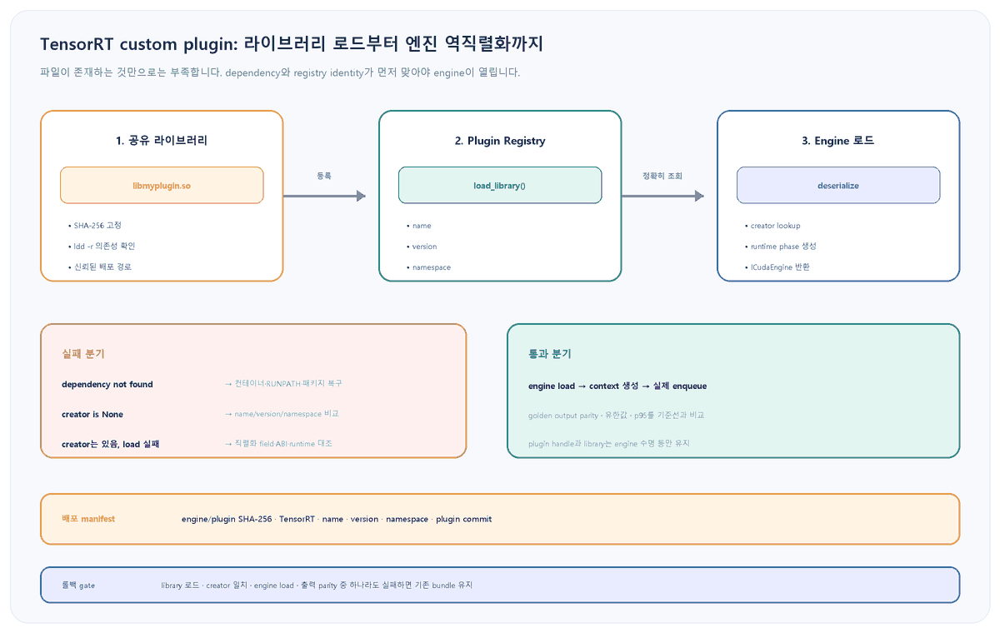

앞선 <a href="https://codersblog.github.io/posts/tensorrt-engine-compatibility-deployment/" style="color:var(--link-color);font-weight:700;text-decoration:underline;">TensorRT 엔진 호환성 배포 진단 초안</a>은 plan 역직렬화 실패를 TensorRT 버전, GPU compute capability, OS·CPU 플랫폼으로 나누고 plugin library를 한 진단 분기로 남겼습니다. 그 글의 한계는 파일이 있는데도 왜 creator를 찾지 못하는지, 어떤 version과 namespace를 맞춰야 하는지, library를 언제 로드해야 하는지를 설명하지 않았다는 점입니다. base runtime과 GPU가 호환되는데도 custom layer가 포함된 engine만 실패한다면 지금 이 다음 단계가 필요합니다.

대상 환경과 실패 증상

Linux x86-64의 TensorRT 11.4.1 full runtime에서 자체 또는 vendor <code style="padding:2px 6px;border-radius:5px;background:var(--card-bg);color:var(--text-color);font-family:Consolas,'Courier New',monospace;">IPluginV3</code> shared library를 쓰는 배포를 가정합니다. 같은 plan이 빌드 서버에서는 열리지만 새 container에서는 <code style="padding:2px 6px;border-radius:5px;background:var(--card-bg);color:var(--text-color);font-family:Consolas,'Courier New',monospace;">getPluginCreator</code> 실패, creator를 찾지 못했다는 로그, <code style="padding:2px 6px;border-radius:5px;background:var(--card-bg);color:var(--text-color);font-family:Consolas,'Courier New',monospace;">deserialize_cuda_engine()</code>의 <code style="padding:2px 6px;border-radius:5px;background:var(--card-bg);color:var(--text-color);font-family:Consolas,'Courier New',monospace;">None</code> 반환이 나타나는 상황입니다. Windows에서는 같은 절차를 DLL dependency 검사와 절대 DLL 경로로 바꿉니다.

<figure style="margin:24px 0 30px;padding:14px;border:1px solid var(--main-border-color);border-radius:14px;background:var(--card-bg);">

<figcaption style="margin:10px 4px 0;color:var(--text-muted-color);font-size:13px;text-align:center;">그림 1. plugin 파일의 존재, registry 등록, engine 역직렬화는 서로 다른 gate입니다. 앞 단계를 확인한 뒤 다음 단계로 이동합니다.</figcaption>
</figure>

<h2 style="margin:34px 0 14px;padding-bottom:9px;border-bottom:2px solid var(--main-border-color);color:var(--heading-color);font-size:23px;">1. engine과 plugin bundle의 신원을 먼저 고정합니다</h2>

실패한 서버에서 바로 <code style="padding:2px 6px;border-radius:5px;background:var(--highlight-bg-color);color:var(--text-color);font-family:Consolas,'Courier New',monospace;">LD_LIBRARY_PATH</code>를 늘리기 전에 plan, plugin, runtime이 배포 manifest와 같은지 확인합니다. <code style="padding:2px 6px;border-radius:5px;background:var(--highlight-bg-color);color:var(--text-color);font-family:Consolas,'Courier New',monospace;">--getPlanVersionOnly</code>는 plan을 역직렬화하지 않고 생성 TensorRT 버전을 읽으므로 plugin 문제와 runtime version 문제를 먼저 분리할 수 있습니다.

<pre style="margin:0 0 14px;padding:18px 20px;overflow:auto;border-radius:12px;background:var(--highlight-bg-color);color:var(--text-color);font-size:14px;line-height:1.55;"><code style="font-family:Consolas,'Courier New',monospace;">python3 -c "import tensorrt as trt; print(trt.__version__)"
trtexec --loadEngine=model.plan --getPlanVersionOnly
sha256sum model.plan /opt/tensorrt-plugins/libmyplugin.so
file /opt/tensorrt-plugins/libmyplugin.so</code></pre>

<strong>기대 관찰값:</strong> runtime과 plan 생성 버전, engine·plugin SHA-256, CPU architecture가 배포 manifest와 일치합니다. plan 생성 버전 자체가 지원 범위 밖이면 plugin을 디버깅하기 전에 대상 runtime에서 재빌드하거나 version-compatible 배포 계약을 다시 확인합니다.

<h3 style="margin:30px 0 12px;color:var(--heading-color);font-size:19px;">shared library가 실제로 로드 가능한지 검사합니다</h3>
<pre style="margin:0 0 14px;padding:18px 20px;overflow:auto;border-radius:12px;background:var(--highlight-bg-color);color:var(--text-color);font-size:14px;line-height:1.55;"><code style="font-family:Consolas,'Courier New',monospace;">ldd -r /opt/tensorrt-plugins/libmyplugin.so
readelf -d /opt/tensorrt-plugins/libmyplugin.so | grep -E 'NEEDED|RPATH|RUNPATH'
ldconfig -p | grep -E 'libnvinfer|libcudart'</code></pre>

<strong>진단 분기:</strong> <code style="padding:2px 6px;border-radius:5px;background:var(--highlight-bg-color);color:var(--text-color);font-family:Consolas,'Courier New',monospace;">not found</code> 또는 unresolved symbol이 있으면 registry 문제로 넘어가지 않습니다. runtime image에 정확한 dependency를 넣거나 plugin의 RUNPATH를 수정한 새 bundle을 빌드합니다. 서비스 전체에 임의의 전역 library path를 추가해 우연히 다른 버전이 먼저 잡히게 하지 않습니다.

<h2 style="margin:34px 0 14px;padding-bottom:9px;border-bottom:2px solid var(--main-border-color);color:var(--heading-color);font-size:23px;">2. name·version·namespace 세 값을 registry에서 확인합니다</h2>

TensorRT는 engine 직렬화 때 plugin creator의 name, version, namespace를 저장합니다. 역직렬화 때 registry에서 세 값이 모두 같은 creator를 찾습니다. 파일명이나 plugin class 이름이 비슷해도 세 값 중 하나가 다르면 다른 plugin입니다. 운영 bundle에는 이 triple과 plugin commit을 반드시 기록합니다.

<pre style="margin:0 0 14px;padding:18px 20px;overflow:auto;border-radius:12px;background:var(--highlight-bg-color);color:var(--text-color);font-size:14px;line-height:1.55;"><code style="font-family:Consolas,'Courier New',monospace;">import os
from pathlib import Path
import tensorrt as trt

plugin_path = str(Path(os.environ["TRT_PLUGIN_PATH"]).resolve())
expected = (
    os.environ["TRT_PLUGIN_NAME"],
    os.environ["TRT_PLUGIN_VERSION"],
    os.environ.get("TRT_PLUGIN_NAMESPACE", ""),
)

logger = trt.Logger(trt.Logger.VERBOSE)
registry = trt.get_plugin_registry()
before = {(c.name, c.plugin_version, c.plugin_namespace) for c in registry.all_creators}
handle = registry.load_library(plugin_path)
after = {(c.name, c.plugin_version, c.plugin_namespace) for c in registry.all_creators}

print("new_creators=", sorted(after - before))
print("expected=", expected)
if handle is None:
    raise RuntimeError("plugin load failed or a creator identity was already registered")
creator = registry.get_creator(*expected)
if creator is None:
    raise RuntimeError("name/version/namespace mismatch")
print("creator_match=", creator.name, creator.plugin_version, creator.plugin_namespace)</code></pre>

<strong>실행 예:</strong> <code style="padding:2px 6px;border-radius:5px;background:var(--highlight-bg-color);color:var(--text-color);font-family:Consolas,'Courier New',monospace;">TRT_PLUGIN_PATH=/opt/tensorrt-plugins/libmyplugin.so TRT_PLUGIN_NAME=MyPlugin TRT_PLUGIN_VERSION=3 TRT_PLUGIN_NAMESPACE=com.example python3 inspect_plugin.py</code>처럼 manifest 값을 환경변수로 줍니다.

<strong>주의:</strong> TensorRT 11에서는 <code style="padding:2px 6px;border-radius:5px;background:var(--highlight-bg-color);color:var(--text-color);font-family:Consolas,'Courier New',monospace;">plugin_creator_list</code>가 deprecated이므로 <code style="padding:2px 6px;border-radius:5px;background:var(--highlight-bg-color);color:var(--text-color);font-family:Consolas,'Courier New',monospace;">all_creators</code>를 사용합니다. <code style="padding:2px 6px;border-radius:5px;background:var(--highlight-bg-color);color:var(--text-color);font-family:Consolas,'Courier New',monospace;">load_library()</code>는 library 안의 creator 하나라도 이미 같은 identity로 등록되어 있으면 실패할 수 있으므로, 배포 smoke test는 plugin을 미리 import하지 않은 새 process에서 실행합니다. static macro는 기본 namespace만 사용하므로 사내·vendor plugin family에는 unique namespace를 주는 dynamic registration이 충돌을 줄입니다.

<h2 style="margin:34px 0 14px;padding-bottom:9px;border-bottom:2px solid var(--main-border-color);color:var(--heading-color);font-size:23px;">3. plugin을 먼저 로드하고 그다음 engine을 엽니다</h2>

application에서 plan을 먼저 읽고 실패한 뒤 plugin을 로드하는 순서는 늦습니다. runtime이 역직렬화를 시작하기 전에 creator가 registry에 있어야 합니다. 먼저 <code style="padding:2px 6px;border-radius:5px;background:var(--highlight-bg-color);color:var(--text-color);font-family:Consolas,'Courier New',monospace;">trtexec</code>로 application code를 배제합니다.

<pre style="margin:0 0 14px;padding:18px 20px;overflow:auto;border-radius:12px;background:var(--highlight-bg-color);color:var(--text-color);font-size:14px;line-height:1.55;"><code style="font-family:Consolas,'Courier New',monospace;">trtexec \
  --loadEngine=model.plan \
  --dynamicPlugins=/opt/tensorrt-plugins/libmyplugin.so \
  --verbose \
  --skipInference</code></pre>

<strong>기대 관찰값:</strong> library가 로드되고 creator lookup과 engine deserialization이 통과합니다. 여기서도 실패하면 Python wrapper나 binding 주소 문제가 아니라 bundle·registry·직렬화 계약 문제입니다. 성공하면 실제 shape와 golden input을 넣어 별도의 inference smoke test로 넘어갑니다.

<h3 style="margin:30px 0 12px;color:var(--heading-color);font-size:19px;">application의 수명 순서를 고정합니다</h3>
<pre style="margin:0 0 14px;padding:18px 20px;overflow:auto;border-radius:12px;background:var(--highlight-bg-color);color:var(--text-color);font-size:14px;line-height:1.55;"><code style="font-family:Consolas,'Courier New',monospace;">import os
from pathlib import Path
import tensorrt as trt

logger = trt.Logger(trt.Logger.INFO)
registry = trt.get_plugin_registry()
plugin_handle = registry.load_library(str(Path(os.environ["TRT_PLUGIN_PATH"]).resolve()))
if plugin_handle is None:
    raise RuntimeError("plugin library was not registered")

runtime = trt.Runtime(logger)
plan = Path("model.plan").read_bytes()
engine = runtime.deserialize_cuda_engine(plan)
if engine is None:
    raise RuntimeError("engine deserialization failed after plugin registration")

# plugin_handle, runtime, engine을 서비스 수명 동안 보관한다.
# 이 다음에 context 생성, 실제 enqueue, golden output 검증을 수행한다.</code></pre>

plugin handle을 즉시 deregister하거나 library를 unload하지 않습니다. 관련 engine·context가 살아 있는 동안 plugin code와 registry resource의 수명을 유지합니다. engine load 성공은 배포 성공이 아니므로 실제 입력으로 output finite check, golden tolerance, target shape, 첫 enqueue와 steady-state p95를 검증합니다.

<h2 style="margin:34px 0 14px;padding-bottom:9px;border-bottom:2px solid var(--main-border-color);color:var(--heading-color);font-size:23px;">4. external plugin과 engine 내 직렬화를 의도적으로 선택합니다</h2>

TensorRT 11.4.1의 <code style="padding:2px 6px;border-radius:5px;background:var(--highlight-bg-color);color:var(--text-color);font-family:Consolas,'Courier New',monospace;">--dynamicPlugins</code>는 build 또는 load 시 library를 동적으로 로드합니다. build 때 <code style="padding:2px 6px;border-radius:5px;background:var(--highlight-bg-color);color:var(--text-color);font-family:Consolas,'Courier New',monospace;">--setPluginsToSerialize</code>까지 주면 plugin library를 plan에 포함합니다. 둘은 배포 계약이 다릅니다.

<pre style="margin:0 0 14px;padding:18px 20px;overflow:auto;border-radius:12px;background:var(--highlight-bg-color);color:var(--text-color);font-size:14px;line-height:1.55;"><code style="font-family:Consolas,'Courier New',monospace;"># 외부 library를 runtime bundle로 함께 배포
trtexec --onnx=model.onnx \
  --dynamicPlugins=/opt/plugins/libmyplugin.so \
  --saveEngine=model.plan --skipInference

# library를 engine에 직렬화하는 별도 계약
trtexec --onnx=model.onnx \
  --dynamicPlugins=/opt/plugins/libmyplugin.so \
  --setPluginsToSerialize=/opt/plugins/libmyplugin.so \
  --saveEngine=model-with-plugin.plan --skipInference</code></pre>
<table style="width:100%;margin:0 0 18px;border-collapse:collapse;border:1px solid var(--main-border-color);background:var(--card-bg);font-size:14px;">
<thead style="background:var(--highlight-bg-color);"><tr style="border-bottom:1px solid var(--main-border-color);"><th style="padding:11px 12px;border-right:1px solid var(--main-border-color);text-align:left;color:var(--heading-color);">관찰</th><th style="padding:11px 12px;border-right:1px solid var(--main-border-color);text-align:left;color:var(--heading-color);">해석</th><th style="padding:11px 12px;text-align:left;color:var(--heading-color);">다음 조치</th></tr></thead>
<tbody style="color:var(--text-color);">
<tr style="border-bottom:1px solid var(--main-border-color);"><td style="padding:10px 12px;border-right:1px solid var(--main-border-color);">ldd -r에서 dependency 누락</td><td style="padding:10px 12px;border-right:1px solid var(--main-border-color);">OS loader 단계 실패</td><td style="padding:10px 12px;">image·RUNPATH·패키지 복구</td></tr>
<tr style="border-bottom:1px solid var(--main-border-color);"><td style="padding:10px 12px;border-right:1px solid var(--main-border-color);">library load, creator 없음</td><td style="padding:10px 12px;border-right:1px solid var(--main-border-color);">identity 또는 등록 방식 불일치</td><td style="padding:10px 12px;">name·version·namespace와 init 경로 비교</td></tr>
<tr style="border-bottom:1px solid var(--main-border-color);"><td style="padding:10px 12px;border-right:1px solid var(--main-border-color);">creator 있음, engine은 None</td><td style="padding:10px 12px;border-right:1px solid var(--main-border-color);">serialized field·plugin ABI·runtime 문제</td><td style="padding:10px 12px;">정확한 plugin commit으로 재빌드</td></tr>
<tr><td style="padding:10px 12px;border-right:1px solid var(--main-border-color);">engine load, 첫 enqueue 실패</td><td style="padding:10px 12px;border-right:1px solid var(--main-border-color);">format·shape·kernel runtime 문제</td><td style="padding:10px 12px;">실제 shape와 CUDA error 진단</td></tr>
</tbody></table>

plugin을 plan 안에 넣으면 단일 artifact가 되지만 plan 자체가 native executable code를 포함하는 신뢰 경계가 더 커집니다. 외부 방식과 포함 방식을 한 release에서 섞지 말고, 어느 쪽이든 engine과 plugin의 출처·해시를 검증합니다. public upload나 신뢰하지 않는 공급자의 plan·plugin은 역직렬화하지 않습니다.

<h3 style="margin:30px 0 12px;color:var(--heading-color);font-size:19px;">배포 manifest에 최소 계약을 남깁니다</h3>
<pre style="margin:0 0 14px;padding:18px 20px;overflow:auto;border-radius:12px;background:var(--highlight-bg-color);color:var(--text-color);font-size:14px;line-height:1.55;"><code style="font-family:Consolas,'Courier New',monospace;">{
  "engine_sha256": "...",
  "tensorrt": "11.4.1",
  "plugin_file": "libmyplugin.so",
  "plugin_sha256": "...",
  "plugin_name": "MyPlugin",
  "plugin_version": "3",
  "plugin_namespace": "com.example",
  "plugin_commit": "...",
  "packaging": "external"
}</code></pre>

engine만 버전 관리하고 plugin identity를 기록하지 않으면 장애 시 어느 library로 재현해야 하는지 알 수 없습니다. bundle promotion은 engine·plugin·manifest를 한 단위로 수행합니다.

<h3 style="margin:30px 0 12px;color:var(--heading-color);font-size:19px;">이 초안의 검증 경계</h3>

NVIDIA TensorRT 11.4.1의 custom layer, advanced plugin, Plugin Registry, runtime, trtexec, migration, security 문서를 대조했습니다. Python 예시는 구문 검사 대상으로 구성했습니다. 이 Windows 작성 환경에는 실제 Linux plugin library, TensorRT plan, target GPU가 연결되어 있지 않아 library load, creator triple, engine deserialization, enqueue, 출력 parity를 실행하지 않았습니다. 대상 container에서 같은 bundle로 smoke test해야 합니다.

<h2 style="margin:34px 0 14px;padding-bottom:9px;border-bottom:2px solid var(--main-border-color);color:var(--heading-color);font-size:23px;">롤백과 배포 기준</h2>
<ul style="margin:0 0 24px;padding-left:24px;color:var(--text-color);">
<li style="margin:8px 0;">기존 production engine·plugin·container digest를 기준선으로 보존하고, plugin library와 engine을 따로 교체하지 않습니다.</li>
<li style="margin:8px 0;"><code style="padding:2px 6px;border-radius:5px;background:var(--highlight-bg-color);color:var(--text-color);font-family:Consolas,'Courier New',monospace;">ldd -r</code>, registry creator triple, engine load 중 하나라도 실패하면 새 bundle promotion을 중단합니다.</li>
<li style="margin:8px 0;">creator identity를 바꿨다면 기존 plan을 억지로 열지 않고 새 identity로 engine을 다시 빌드합니다.</li>
<li style="margin:8px 0;">engine load가 성공해도 golden output tolerance, finite output, target shape, p95가 기준선을 통과하지 않으면 이전 bundle로 되돌립니다.</li>
<li style="margin:8px 0;">중복 creator 충돌을 registration 순서로 숨기지 말고 unique namespace와 새 process smoke test로 제거합니다.</li>
<li style="margin:8px 0;">출처나 해시를 검증할 수 없는 plan 또는 plugin은 진단 편의를 위해서도 로드하지 않습니다.</li>
</ul>

<h2 style="margin:34px 0 14px;padding-bottom:9px;border-bottom:2px solid var(--main-border-color);color:var(--heading-color);font-size:23px;">공식 출처</h2>
<ul style="margin:0 0 26px;padding-left:24px;color:var(--text-color);">
<li style="margin:8px 0;"><a href="https://docs.nvidia.com/deeplearning/tensorrt/11.4.1/inference-library/plugins-cpp.html" style="color:var(--link-color);text-decoration:underline;">NVIDIA TensorRT 11.4.1: Adding Custom Layers Using the C++ API</a></li>
<li style="margin:8px 0;"><a href="https://docs.nvidia.com/deeplearning/tensorrt/11.4.1/inference-library/plugins-advanced.html" style="color:var(--link-color);text-decoration:underline;">NVIDIA TensorRT 11.4.1: Advanced Plugin Topics</a></li>
<li style="margin:8px 0;"><a href="https://docs.nvidia.com/deeplearning/tensorrt/11.4.1/_static/python-api/infer/Plugin/IPluginRegistry.html" style="color:var(--link-color);text-decoration:underline;">NVIDIA IPluginRegistry Python API: all_creators, get_creator, load_library</a></li>
<li style="margin:8px 0;"><a href="https://docs.nvidia.com/deeplearning/tensorrt/11.4.1/_static/python-api/infer/Core/Runtime.html" style="color:var(--link-color);text-decoration:underline;">NVIDIA Runtime Python API: deserialize_cuda_engine과 local registry</a></li>
<li style="margin:8px 0;"><a href="https://docs.nvidia.com/deeplearning/tensorrt/11.4.1/performance/benchmarking.html" style="color:var(--link-color);text-decoration:underline;">NVIDIA TensorRT Benchmarking: dynamicPlugins와 setPluginsToSerialize</a></li>
<li style="margin:8px 0;"><a href="https://docs.nvidia.com/deeplearning/tensorrt/11.4.1/api/migration/tensorrt-10x-to-11x-python-api-patterns.html" style="color:var(--link-color);text-decoration:underline;">NVIDIA TensorRT 11 Python Migration: IPluginV3와 IPluginCreatorV3One</a></li>
<li style="margin:8px 0;"><a href="https://docs.nvidia.com/deeplearning/tensorrt/11.4.1/reference/security.html" style="color:var(--link-color);text-decoration:underline;">NVIDIA TensorRT Security Considerations: engine과 plugin trust boundary</a></li>
<li style="margin:8px 0;"><a href="https://docs.nvidia.com/deeplearning/tensorrt/latest/getting-started/release-notes.html" style="color:var(--link-color);text-decoration:underline;">NVIDIA TensorRT 11.4.1 Release Notes</a></li>
</ul>

