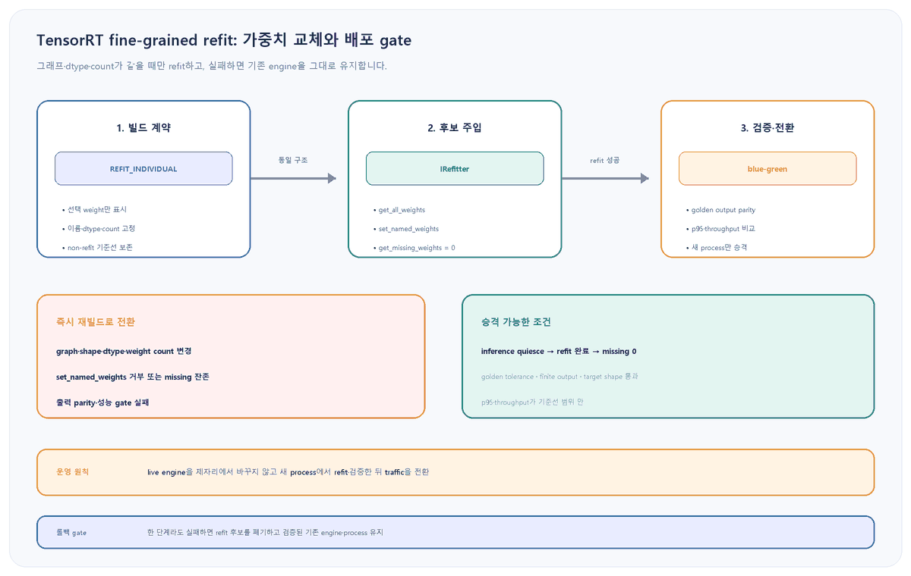

앞선 <a href="https://codersblog.github.io/posts/tensorrt-timing-cache-safe-reuse/" style="color:var(--link-color);font-weight:700;text-decoration:underline;">TensorRT timing cache 글</a>은 같은 구조의 engine을 다시 빌드할 때 tactic 측정 시간을 줄이는 방법을 다뤘습니다. 그 글의 한계는 classifier head나 adapter처럼 일부 weight만 바뀌어도 여전히 전체 build가 필요하다는 점입니다. 이번 글은 build 단계에서 refit 계약을 미리 넣어 둔 engine에 한해 새 weight를 주입하는 다음 단계를 설명합니다. refit은 임의의 새 ONNX를 기존 plan에 덮어쓰는 기능이 아니므로, 구조가 달라졌다면 지금도 전체 재빌드가 정답입니다.

대상 환경과 실패 증상

Linux x86-64, NVIDIA dGPU, TensorRT 11.4.1 full runtime, ONNX에서 만든 dynamic-shape engine을 가정합니다. backbone과 I/O shape는 그대로인데 분류 head 두 weight만 재학습되어 전체 build가 수십 분 걸리거나, 운영 중 <code style="padding:2px 6px;border-radius:5px;background:var(--card-bg);color:var(--text-color);font-family:Consolas,'Courier New',monospace;">set_named_weights()</code>가 <code style="padding:2px 6px;border-radius:5px;background:var(--card-bg);color:var(--text-color);font-family:Consolas,'Courier New',monospace;">False</code>를 반환하고 <code style="padding:2px 6px;border-radius:5px;background:var(--card-bg);color:var(--text-color);font-family:Consolas,'Courier New',monospace;">get_missing_weights()</code>가 남는 상황입니다. 목표는 live engine을 제자리에서 바꾸는 것이 아니라 별도 후보 process에서 refit·검증한 뒤 traffic을 전환하는 것입니다.

<figure style="margin:24px 0 30px;padding:14px;border:1px solid var(--main-border-color);border-radius:14px;background:var(--card-bg);">

<figcaption style="margin:10px 4px 0;color:var(--text-muted-color);font-size:13px;text-align:center;">그림 1. refit은 빠른 배포 경로이지 검증 생략 경로가 아닙니다. 구조 계약과 결과 gate 중 하나라도 실패하면 후보를 폐기합니다.</figcaption>
</figure>

<h2 style="margin:34px 0 14px;padding-bottom:9px;border-bottom:2px solid var(--main-border-color);color:var(--heading-color);font-size:23px;">1. 먼저 refit 가능한 변경인지 판정합니다</h2>

refit은 engine build 때 refittable로 표시한 weight의 값만 바꿉니다. weight 이름이 같아도 element count나 dtype이 달라지면 거부됩니다. operator, I/O shape, optimization profile, precision 표현, plugin field, weight sparsity 방식이 바뀌었다면 tactic과 fusion을 다시 선택해야 하므로 새 engine을 빌드합니다.

<pre style="margin:0 0 14px;padding:18px 20px;overflow:auto;border-radius:12px;background:var(--highlight-bg-color);color:var(--text-color);font-size:14px;line-height:1.55;"><code style="font-family:Consolas,'Courier New',monospace;">python3 -c "import tensorrt as trt; print(trt.__version__)"
sha256sum baseline.onnx candidate.onnx baseline-refit.plan
trtexec --loadEngine=baseline-refit.plan --getPlanVersionOnly
python3 -m pip show onnx tensorrt</code></pre>

<strong>기대 관찰값:</strong> runtime과 plan의 TensorRT 계약이 맞고, baseline·candidate ONNX는 graph와 initializer metadata가 동일하며 값만 다릅니다. 단순 파일 해시는 weight 값이 바뀌면 당연히 달라지므로 graph·initializer 이름·dtype·shape manifest를 별도로 비교합니다.

<table style="width:100%;margin:0 0 18px;border-collapse:collapse;border:1px solid var(--main-border-color);background:#ffffff;font-size:14px;">
<thead style="background:var(--highlight-bg-color);"><tr style="border-bottom:1px solid var(--main-border-color);"><th style="padding:11px 12px;border-right:1px solid var(--main-border-color);text-align:left;color:var(--heading-color);">변경</th><th style="padding:11px 12px;border-right:1px solid var(--main-border-color);text-align:left;color:var(--heading-color);">판정</th><th style="padding:11px 12px;text-align:left;color:var(--heading-color);">이유</th></tr></thead>
<tbody style="color:var(--text-color);">
<tr style="border-bottom:1px solid var(--main-border-color);"><td style="padding:10px 12px;border-right:1px solid var(--main-border-color);">표시한 head weight 값만 변경</td><td style="padding:10px 12px;border-right:1px solid var(--main-border-color);">refit 후보</td><td style="padding:10px 12px;">이름·dtype·count 유지</td></tr>
<tr style="border-bottom:1px solid var(--main-border-color);"><td style="padding:10px 12px;border-right:1px solid var(--main-border-color);">class 수·kernel shape 변경</td><td style="padding:10px 12px;border-right:1px solid var(--main-border-color);">전체 재빌드</td><td style="padding:10px 12px;">weight count와 output shape 변경</td></tr>
<tr style="border-bottom:1px solid var(--main-border-color);"><td style="padding:10px 12px;border-right:1px solid var(--main-border-color);">Q/DQ·precision·plugin 변경</td><td style="padding:10px 12px;border-right:1px solid var(--main-border-color);">전체 재빌드</td><td style="padding:10px 12px;">tactic·fusion·직렬화 계약 변경</td></tr>
<tr><td style="padding:10px 12px;border-right:1px solid var(--main-border-color);">기존 plan이 refit 비활성</td><td style="padding:10px 12px;border-right:1px solid var(--main-border-color);">전체 재빌드</td><td style="padding:10px 12px;">사후에 refittable로 바꿀 수 없음</td></tr>
</tbody></table>

<h2 style="margin:34px 0 14px;padding-bottom:9px;border-bottom:2px solid var(--main-border-color);color:var(--heading-color);font-size:23px;">2. 선택 weight만 REFIT_INDIVIDUAL로 빌드합니다</h2>

모든 weight를 refittable로 만드는 <code style="padding:2px 6px;border-radius:5px;background:var(--highlight-bg-color);color:var(--text-color);font-family:Consolas,'Courier New',monospace;">REFIT</code>은 상수 folding과 fusion을 제한할 수 있습니다. 바뀌는 head weight를 정확히 알고 있다면 이름을 고정하고 그 weight만 표시한 뒤 <code style="padding:2px 6px;border-radius:5px;background:var(--highlight-bg-color);color:var(--text-color);font-family:Consolas,'Courier New',monospace;">REFIT_INDIVIDUAL</code>로 build합니다.

<pre style="margin:0 0 14px;padding:18px 20px;overflow:auto;border-radius:12px;background:var(--highlight-bg-color);color:var(--text-color);font-size:14px;line-height:1.55;"><code style="font-family:Consolas,'Courier New',monospace;">import tensorrt as trt

logger = trt.Logger(trt.Logger.INFO)
builder = trt.Builder(logger)
network = builder.create_network(0)
config = builder.create_builder_config()

# parse한 network에서 실제 canonical Weights 객체를 얻었다고 가정한다.
head_kernel = ...
head_bias = ...
network.set_weights_name(head_kernel, "classifier.weight")
network.set_weights_name(head_bias, "classifier.bias")
network.mark_weights_refittable("classifier.weight")
network.mark_weights_refittable("classifier.bias")
if not network.are_weights_marked_refittable("classifier.weight"):
    raise RuntimeError("classifier.weight was not marked refittable")

config.set_flag(trt.BuilderFlag.REFIT_INDIVIDUAL)
plan = builder.build_serialized_network(network, config)
if plan is None:
    raise RuntimeError("refittable engine build failed")</code></pre>

<strong>중요:</strong> ONNX parser가 initializer 이름을 weight 이름과 연결하지만, 실제 engine이 노출하는 이름을 build artifact와 함께 기록해야 합니다. 위의 <code style="padding:2px 6px;border-radius:5px;background:var(--highlight-bg-color);color:var(--text-color);font-family:Consolas,'Courier New',monospace;">head_kernel</code>과 <code style="padding:2px 6px;border-radius:5px;background:var(--highlight-bg-color);color:var(--text-color);font-family:Consolas,'Courier New',monospace;">head_bias</code>는 parser 후 network에서 얻은 실제 weight 객체로 바꿉니다. 임의의 NumPy 복사본에 이름을 붙이지 않습니다.

TensorRT 11.4.1 문서는 일반 <code style="padding:2px 6px;border-radius:5px;background:var(--highlight-bg-color);color:var(--text-color);font-family:Consolas,'Courier New',monospace;">REFIT</code> engine이 refit을 하지 않아도 non-refit engine과 다른 잘못된 수치 출력을 낼 수 있는 알려진 문제를 경고합니다. 따라서 fine-grained 경로를 쓰더라도 같은 ONNX에서 만든 non-refit engine을 정확성 기준선으로 보존하고, 대상 버전의 release note를 확인합니다.

<h3 style="margin:30px 0 12px;color:var(--heading-color);font-size:19px;">build 직후 refit inventory를 manifest로 남깁니다</h3>
<pre style="margin:0 0 14px;padding:18px 20px;overflow:auto;border-radius:12px;background:var(--highlight-bg-color);color:var(--text-color);font-size:14px;line-height:1.55;"><code style="font-family:Consolas,'Courier New',monospace;">from pathlib import Path
import tensorrt as trt

logger = trt.Logger(trt.Logger.INFO)
runtime = trt.Runtime(logger)
engine = runtime.deserialize_cuda_engine(Path("baseline-refit.plan").read_bytes())
if engine is None:
    raise RuntimeError("engine load failed")

refitter = trt.Refitter(engine, logger)
for name in refitter.get_all_weights():
    prototype = refitter.get_weights_prototype(name)
    print(name, prototype.dtype, prototype.size)</code></pre>

<strong>기대 관찰값:</strong> 허용한 두 weight만 보이고 각 prototype의 dtype과 size가 release manifest와 일치합니다. 예상하지 않은 backbone weight가 보이면 build 설정을 되돌리고 marking 범위를 다시 확인합니다.

<h2 style="margin:34px 0 14px;padding-bottom:9px;border-bottom:2px solid var(--main-border-color);color:var(--heading-color);font-size:23px;">3. 후보 weight를 넣고 missing이 0인지 확인합니다</h2>

후보 파일을 바로 live engine에 넣지 않습니다. 새 process에서 기존 plan을 읽고, manifest와 같은 두 이름의 <code style="padding:2px 6px;border-radius:5px;background:var(--highlight-bg-color);color:var(--text-color);font-family:Consolas,'Courier New',monospace;">trt.Weights</code>를 준비합니다. 아래의 <code style="padding:2px 6px;border-radius:5px;background:var(--highlight-bg-color);color:var(--text-color);font-family:Consolas,'Courier New',monospace;">WEIGHTS</code>는 exporter가 contiguous host buffer와 함께 생성한 dictionary이며 refit이 끝날 때까지 그 배열의 수명을 유지해야 합니다.

<pre style="margin:0 0 14px;padding:18px 20px;overflow:auto;border-radius:12px;background:var(--highlight-bg-color);color:var(--text-color);font-size:14px;line-height:1.55;"><code style="font-family:Consolas,'Courier New',monospace;">from pathlib import Path
import tensorrt as trt
from candidate_weights import WEIGHTS

logger = trt.Logger(trt.Logger.VERBOSE)
runtime = trt.Runtime(logger)
engine = runtime.deserialize_cuda_engine(Path("baseline-refit.plan").read_bytes())
if engine is None:
    raise RuntimeError("engine load failed")

refitter = trt.Refitter(engine, logger)
refitter.weights_validation = True
expected = {"classifier.weight", "classifier.bias"}
if set(refitter.get_all_weights()) != expected:
    raise RuntimeError("refit inventory differs from the release manifest")

for name in sorted(expected):
    prototype = refitter.get_weights_prototype(name)
    candidate = WEIGHTS[name]
    if candidate.dtype != prototype.dtype or candidate.size != prototype.size:
        raise RuntimeError(f"prototype mismatch: {name}")
    if not refitter.set_named_weights(name, candidate):
        raise RuntimeError(f"set_named_weights rejected: {name}")

missing = refitter.get_missing_weights()
if missing:
    raise RuntimeError(f"missing refit weights: {missing}")
if not refitter.refit_cuda_engine():
    raise RuntimeError("refit failed; discard this engine instance")

serialized = engine.serialize()
Path("candidate-refitted.plan").write_bytes(bytes(serialized))</code></pre>

<strong>실패 분기:</strong> <code style="padding:2px 6px;border-radius:5px;background:var(--highlight-bg-color);color:var(--text-color);font-family:Consolas,'Courier New',monospace;">set_named_weights()</code>가 거부되면 이름·dtype·size 중 하나가 build 계약과 다릅니다. 일부 weight를 설정한 뒤 missing 목록이 생기면 TensorRT가 최적화 과정에서 결합한 연관 weight도 요구하는 상황입니다. 해당 목록을 임의의 zero weight로 채우지 말고 exporter와 manifest를 고칩니다.

<strong>중단 기준:</strong> <code style="padding:2px 6px;border-radius:5px;background:var(--highlight-bg-color);color:var(--text-color);font-family:Consolas,'Courier New',monospace;">refit_cuda_engine()</code>이 <code style="padding:2px 6px;border-radius:5px;background:var(--highlight-bg-color);color:var(--text-color);font-family:Consolas,'Courier New',monospace;">False</code>를 반환하면 일부 weight만 반영됐을 수 있으므로 그 engine instance는 더 이상 추론에 사용하지 않습니다. 로그를 보존하고 process 전체를 폐기합니다.

<h2 style="margin:34px 0 14px;padding-bottom:9px;border-bottom:2px solid var(--main-border-color);color:var(--heading-color);font-size:23px;">4. inference를 멈춘 상태에서만 refit합니다</h2>

refit은 engine을 변경합니다. 같은 engine에서 만든 어떤 execution context에도 pending inference가 없어야 하며, async refit을 쓴다면 refit stream과 모든 inference stream의 순서를 명시적으로 연결해야 합니다. 가장 단순하고 안전한 운영 방식은 새 process가 traffic을 받기 전에 동기 refit을 완료하는 blue-green 전환입니다.

<pre style="margin:0 0 14px;padding:18px 20px;overflow:auto;border-radius:12px;background:var(--highlight-bg-color);color:var(--text-color);font-size:14px;line-height:1.55;"><code style="font-family:Consolas,'Courier New',monospace;"># blue process는 계속 serving한다.
systemctl start vision-green-refit.service
curl -fsS http://127.0.0.1:18081/health/refit
curl -fsS http://127.0.0.1:18081/health/inference

# golden·부하 gate 통과 후에만 load balancer를 green으로 전환한다.
# 실패하면 green만 중지하고 blue traffic은 그대로 유지한다.
systemctl stop vision-green-refit.service</code></pre>
<ul style="margin:0 0 24px;padding-left:24px;color:var(--text-color);">
<li style="margin:8px 0;"><strong>금지:</strong> 요청이 들어오는 live engine에 별도 thread로 refit하지 않습니다.</li>
<li style="margin:8px 0;"><strong>허용:</strong> 새 process의 startup 단계에서 context 생성 전 또는 모든 context가 idle인 상태로 refit합니다.</li>
<li style="margin:8px 0;"><strong>async 경로:</strong> <code style="padding:2px 6px;border-radius:5px;background:var(--highlight-bg-color);color:var(--text-color);font-family:Consolas,'Courier New',monospace;">refit_cuda_engine_async()</code>는 같은 engine의 다른 stream에 pending work가 없도록 하고 완료 event를 기다린 뒤 serving을 시작합니다.</li>
<li style="margin:8px 0;"><strong>소유권:</strong> host 또는 device weight buffer는 refit 호출이 완료되기 전에 수정·해제하지 않습니다.</li>
</ul>

<h2 style="margin:34px 0 14px;padding-bottom:9px;border-bottom:2px solid var(--main-border-color);color:var(--heading-color);font-size:23px;">5. 출력과 성능을 non-refit 기준선과 비교합니다</h2>

refit API의 성공은 weight 적용 절차가 끝났다는 뜻이지 모델 정확성이 맞다는 뜻이 아닙니다. 같은 candidate ONNX에서 전체 재빌드한 non-refit engine을 기준선으로 만들고, 고정된 golden input에 대해 refitted engine과 output을 비교합니다. NaN·Inf, 최대 절대오차, 최대 상대오차, task metric을 함께 봅니다.

<pre style="margin:0 0 14px;padding:18px 20px;overflow:auto;border-radius:12px;background:var(--highlight-bg-color);color:var(--text-color);font-size:14px;line-height:1.55;"><code style="font-family:Consolas,'Courier New',monospace;">import numpy as np

golden = np.load("candidate-full-rebuild-output.npz")
actual = np.load("candidate-refitted-output.npz")
for name in golden.files:
    reference = golden[name]
    value = actual[name]
    if not np.isfinite(value).all():
        raise RuntimeError(f"non-finite output: {name}")
    np.testing.assert_allclose(value, reference, rtol=1e-4, atol=1e-5)
    print(name, "max_abs=", np.max(np.abs(value - reference)))</code></pre>
<pre style="margin:0 0 14px;padding:18px 20px;overflow:auto;border-radius:12px;background:var(--highlight-bg-color);color:var(--text-color);font-size:14px;line-height:1.55;"><code style="font-family:Consolas,'Courier New',monospace;">trtexec --loadEngine=candidate-full-rebuild.plan --shapes=images:4x3x640x640 --warmUp=1000 --duration=60 --iterations=200

trtexec --loadEngine=candidate-refitted.plan --shapes=images:4x3x640x640 --warmUp=1000 --duration=60 --iterations=200</code></pre>

<strong>배포 gate:</strong> 모든 target shape의 출력 parity와 task metric이 통과하고, p50·p95·throughput이 non-refit 기준선의 허용 범위 안에 있어야 합니다. refit은 build 시간을 줄일 수 있지만 runtime이 빨라진다는 보장은 없습니다. 일반 REFIT 때문에 fusion이 줄어든 경우 fine-grained marking으로 좁히거나 전체 재빌드 engine을 배포합니다.

<h3 style="margin:30px 0 12px;color:var(--heading-color);font-size:19px;">이 초안의 검증 경계</h3>

NVIDIA TensorRT 11.4.1의 refit guide, Refitter·OnnxParserRefitter Python API, troubleshooting FAQ, performance 문서와 release note를 대조했습니다. Python 예시는 구문 검사 대상으로 구성했습니다. 이 Windows 작성 환경에는 TensorRT 11.4.1 GPU, 실제 ONNX initializer exporter, refittable plan이 없어 build·refit·serialize·golden parity·p95를 실행하지 않았습니다. 특히 현재 문서의 REFIT 수치 정확성 known issue는 대상 패치 버전 release note와 실제 non-refit 비교로 다시 확인해야 합니다.

<h2 style="margin:34px 0 14px;padding-bottom:9px;border-bottom:2px solid var(--main-border-color);color:var(--heading-color);font-size:23px;">롤백과 배포 기준</h2>
<ul style="margin:0 0 24px;padding-left:24px;color:var(--text-color);">
<li style="margin:8px 0;">검증된 non-refit production engine과 blue process를 traffic 전환이 끝날 때까지 보존합니다.</li>
<li style="margin:8px 0;">graph·initializer dtype·shape·count 중 하나라도 다르면 refit을 시도하지 않고 전체 재빌드합니다.</li>
<li style="margin:8px 0;"><code style="padding:2px 6px;border-radius:5px;background:var(--highlight-bg-color);color:var(--text-color);font-family:Consolas,'Courier New',monospace;">set_named_weights()</code>, missing-zero gate, <code style="padding:2px 6px;border-radius:5px;background:var(--highlight-bg-color);color:var(--text-color);font-family:Consolas,'Courier New',monospace;">refit_cuda_engine()</code> 중 하나라도 실패하면 해당 process를 폐기합니다.</li>
<li style="margin:8px 0;">출력 parity·finite check·task metric·target shape·p95 중 하나라도 실패하면 green으로 traffic을 보내지 않습니다.</li>
<li style="margin:8px 0;">일부 weight만 반영된 engine을 원복하려 하지 말고 검증된 plan에서 새 process를 다시 시작합니다.</li>
<li style="margin:8px 0;">broad all-weight REFIT이 필요하거나 non-refit 대비 성능·정확성 차이가 설명되지 않으면 timing cache를 활용한 전체 재빌드 경로로 돌아갑니다.</li>
</ul>

<h2 style="margin:34px 0 14px;padding-bottom:9px;border-bottom:2px solid var(--main-border-color);color:var(--heading-color);font-size:23px;">공식 출처</h2>
<ul style="margin:0 0 26px;padding-left:24px;color:var(--text-color);">
<li style="margin:8px 0;"><a href="https://docs.nvidia.com/deeplearning/tensorrt/11.4.1/inference-library/refitting-engines.html" style="color:var(--link-color);text-decoration:underline;">NVIDIA TensorRT 11.4.1: Refitting an Engine</a></li>
<li style="margin:8px 0;"><a href="https://docs.nvidia.com/deeplearning/tensorrt/latest/_static/python-api/infer/Core/Refitter.html" style="color:var(--link-color);text-decoration:underline;">NVIDIA Refitter Python API: prototype, missing, validation, async refit</a></li>
<li style="margin:8px 0;"><a href="https://docs.nvidia.com/deeplearning/tensorrt/latest/_static/python-api/parsers/Onnx/pyOnnx.html" style="color:var(--link-color);text-decoration:underline;">NVIDIA OnnxParserRefitter Python API</a></li>
<li style="margin:8px 0;"><a href="https://docs.nvidia.com/deeplearning/tensorrt/11.4.1/reference/troubleshooting-faq.html" style="color:var(--link-color);text-decoration:underline;">NVIDIA TensorRT 11.4.1 FAQ: refit과 non-refit 비교</a></li>
<li style="margin:8px 0;"><a href="https://docs.nvidia.com/deeplearning/tensorrt/11.4.1/performance/benchmarking.html" style="color:var(--link-color);text-decoration:underline;">NVIDIA TensorRT Performance Benchmarking</a></li>
<li style="margin:8px 0;"><a href="https://docs.nvidia.com/deeplearning/tensorrt/11.4.1/reference/security.html" style="color:var(--link-color);text-decoration:underline;">NVIDIA TensorRT Security Considerations</a></li>
<li style="margin:8px 0;"><a href="https://docs.nvidia.com/deeplearning/tensorrt/latest/getting-started/release-notes.html" style="color:var(--link-color);text-decoration:underline;">NVIDIA TensorRT 11.4.1 Release Notes</a></li>
</ul>

