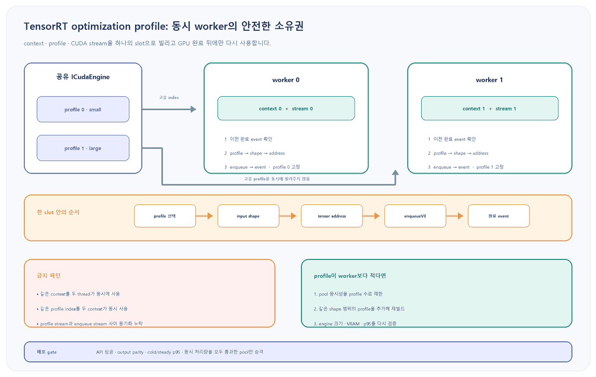

앞선 <a href="https://codersblog.github.io/posts/tensorrt-dynamic-shape-profiles/" style="color:var(--link-color);font-weight:700;text-decoration:underline;">TensorRT Dynamic Shape Profile 글</a>은 실제 입력 분포로 min·opt·max를 정하고 범위 밖 shape를 차단하는 방법을 다뤘습니다. 그 글의 한계는 하나의 engine을 여러 worker가 동시에 사용할 때 각 execution context가 어느 profile을 소유해야 하는지, profile을 바꾼 뒤 어떤 CUDA stream에서 순서를 보장해야 하는지까지 다루지 않았다는 점입니다. worker pool을 늘린 지금은 profile 범위만 맞추는 것으로 부족합니다. profile 소유권과 비동기 전환 순서가 깨지면 같은 shape도 간헐적으로 실패하거나 첫 요청 지연이 튈 수 있습니다.

대상 환경과 실패 증상

Linux x86-64, NVIDIA dGPU, TensorRT 11.4.1, 동적 입력 <code style="padding:2px 6px;border-radius:5px;background:var(--card-bg);color:var(--text-color);font-family:Consolas,'Courier New',monospace;">images</code>를 가진 engine과 둘 이상의 worker/context를 가정합니다. 단일 worker에서는 정상인데 동시 요청에서 <code style="padding:2px 6px;border-radius:5px;background:var(--card-bg);color:var(--text-color);font-family:Consolas,'Courier New',monospace;">set_optimization_profile_async()</code>, <code style="padding:2px 6px;border-radius:5px;background:var(--card-bg);color:var(--text-color);font-family:Consolas,'Courier New',monospace;">set_input_shape()</code>, <code style="padding:2px 6px;border-radius:5px;background:var(--card-bg);color:var(--text-color);font-family:Consolas,'Courier New',monospace;">execute_async_v3()</code> 중 하나가 실패하거나, profile/shape 변경 직후 p95만 급증하는 상황입니다.

<figure style="margin:24px 0 30px;padding:14px;border:1px solid var(--main-border-color);border-radius:14px;background:var(--card-bg);">

<figcaption style="margin:10px 4px 0;color:var(--text-muted-color);font-size:13px;text-align:center;">그림 1. profile은 shape 범위표이면서 동시 context의 실행 상태입니다. context·profile·stream을 한 슬롯으로 빌리고 GPU 완료 뒤에만 다시 사용합니다.</figcaption>
</figure>

<h2 style="margin:34px 0 14px;padding-bottom:9px;border-bottom:2px solid var(--main-border-color);color:var(--heading-color);font-size:23px;">1. engine의 profile 범위를 먼저 목록화합니다</h2>

요청 router가 감으로 profile 번호를 고르면 안 됩니다. 배포 artifact에서 profile 수와 각 입력의 min·opt·max를 읽어 release manifest와 비교합니다. profile은 추가된 순서대로 0부터 번호가 붙습니다.

<pre style="margin:0 0 14px;padding:18px 20px;overflow:auto;border-radius:12px;background:var(--highlight-bg-color);color:var(--text-color);font-size:14px;line-height:1.55;"><code style="font-family:Consolas,'Courier New',monospace;">python3 -c "import tensorrt as trt; print(trt.__version__)"
sha256sum model-dynamic.plan
nvidia-smi --query-gpu=index,name,uuid,driver_version --format=csv</code></pre>
<pre style="margin:0 0 14px;padding:18px 20px;overflow:auto;border-radius:12px;background:var(--highlight-bg-color);color:var(--text-color);font-size:14px;line-height:1.55;"><code style="font-family:Consolas,'Courier New',monospace;">from pathlib import Path
import tensorrt as trt

logger = trt.Logger(trt.Logger.INFO)
runtime = trt.Runtime(logger)
engine = runtime.deserialize_cuda_engine(Path("model-dynamic.plan").read_bytes())
if engine is None:
    raise RuntimeError("engine deserialization failed")

print("profiles=", engine.num_optimization_profiles)
for profile_index in range(engine.num_optimization_profiles):
    minimum, optimum, maximum = engine.get_tensor_profile_shape(
        "images", profile_index
    )
    print(profile_index, "min=", minimum, "opt=", optimum, "max=", maximum)</code></pre>

<strong>기대 관찰값:</strong> 배포가 두 동시 worker를 요구한다면 최소 두 profile이 보이고, 각 worker가 받을 shape가 해당 범위 안에 있습니다. 두 profile은 범위가 겹쳐도 됩니다. 단, 같은 범위를 가진 profile이 둘이라는 사실과 하나의 profile을 두 context가 동시에 사용한다는 것은 다릅니다.

<h3 style="margin:30px 0 12px;color:var(--heading-color);font-size:19px;">요청 shape가 어느 profile에 들어가는지 코드로 판정합니다</h3>
<pre style="margin:0 0 14px;padding:18px 20px;overflow:auto;border-radius:12px;background:var(--highlight-bg-color);color:var(--text-color);font-size:14px;line-height:1.55;"><code style="font-family:Consolas,'Courier New',monospace;">def covers(shape, minimum, maximum):
    return len(shape) == len(minimum) and all(
        int(lo) &lt;= int(value) &lt;= int(hi)
        for value, lo, hi in zip(shape, minimum, maximum)
    )

requested = (4, 3, 640, 640)
candidates = []
for profile_index in range(engine.num_optimization_profiles):
    minimum, _, maximum = engine.get_tensor_profile_shape("images", profile_index)
    if covers(requested, minimum, maximum):
        candidates.append(profile_index)
print("shape=", requested, "candidate_profiles=", candidates)
if not candidates:
    raise RuntimeError("shape is outside every optimization profile")</code></pre>

<strong>진단 분기:</strong> 후보가 0개면 동시성 문제가 아니라 build 계약 밖 입력입니다. 하나 이상이면 범위가 맞는 profile 중 현재 비어 있는 worker를 선택합니다. 범위를 만족한다는 이유만으로 사용 중인 profile을 빼앗지 않습니다.

<h2 style="margin:34px 0 14px;padding-bottom:9px;border-bottom:2px solid var(--main-border-color);color:var(--heading-color);font-size:23px;">2. worker마다 context·profile·stream을 고정합니다</h2>

TensorRT의 실행 context는 동적 shape, profile index, activation 상태를 보관하므로 여러 thread가 한 context를 동시에 공유할 수 없습니다. 동적 shape engine에서 여러 context를 동시에 실행한다면 각 context는 다른 optimization profile을 사용해야 합니다. 새 context가 profile 0으로 시작하더라도 암묵적 선택에 기대지 말고 worker 초기화 단계에서 고유 index를 명시합니다.

<pre style="margin:0 0 14px;padding:18px 20px;overflow:auto;border-radius:12px;background:var(--highlight-bg-color);color:var(--text-color);font-size:14px;line-height:1.55;"><code style="font-family:Consolas,'Courier New',monospace;">import torch

class Worker:
    def __init__(self, engine, profile_index):
        self.context = engine.create_execution_context()
        if self.context is None:
            raise RuntimeError("execution context creation failed")
        self.profile_index = profile_index
        self.stream = torch.cuda.Stream()
        self.done = torch.cuda.Event(blocking=False)
        self.busy = False

workers = [
    Worker(engine, profile_index=0),
    Worker(engine, profile_index=1),
]
if len({worker.profile_index for worker in workers}) != len(workers):
    raise RuntimeError("concurrent workers must not share a profile index")</code></pre>
<table style="width:100%;margin:0 0 18px;border-collapse:collapse;border:1px solid var(--main-border-color);background:#ffffff;font-size:14px;">
<thead style="background:var(--highlight-bg-color);"><tr style="border-bottom:1px solid var(--main-border-color);"><th style="padding:11px 12px;border-right:1px solid var(--main-border-color);text-align:left;color:var(--heading-color);">상태</th><th style="padding:11px 12px;border-right:1px solid var(--main-border-color);text-align:left;color:var(--heading-color);">판정</th><th style="padding:11px 12px;text-align:left;color:var(--heading-color);">안전한 조치</th></tr></thead>
<tbody style="color:var(--text-color);">
<tr style="border-bottom:1px solid var(--main-border-color);"><td style="padding:10px 12px;border-right:1px solid var(--main-border-color);">context 2개, profile 2개</td><td style="padding:10px 12px;border-right:1px solid var(--main-border-color);">동시 실행 가능</td><td style="padding:10px 12px;">고유 mapping과 별도 stream 유지</td></tr>
<tr style="border-bottom:1px solid var(--main-border-color);"><td style="padding:10px 12px;border-right:1px solid var(--main-border-color);">context 4개, profile 2개</td><td style="padding:10px 12px;border-right:1px solid var(--main-border-color);">동시 4개 불가</td><td style="padding:10px 12px;">pool 동시성을 2로 제한하거나 profile 추가 재빌드</td></tr>
<tr style="border-bottom:1px solid var(--main-border-color);"><td style="padding:10px 12px;border-right:1px solid var(--main-border-color);">한 context를 thread 2개가 공유</td><td style="padding:10px 12px;border-right:1px solid var(--main-border-color);">정의되지 않은 동작</td><td style="padding:10px 12px;">thread별 context 또는 전체 GPU 완료까지 직렬화</td></tr>
<tr><td style="padding:10px 12px;border-right:1px solid var(--main-border-color);">profile 범위는 같고 index만 다름</td><td style="padding:10px 12px;border-right:1px solid var(--main-border-color);">동시 slot 구성 가능</td><td style="padding:10px 12px;">engine 크기·VRAM·latency를 다시 측정</td></tr>
</tbody></table>

<h2 style="margin:34px 0 14px;padding-bottom:9px;border-bottom:2px solid var(--main-border-color);color:var(--heading-color);font-size:23px;">3. profile 선택과 enqueue를 같은 stream에 넣습니다</h2>

<code style="padding:2px 6px;border-radius:5px;background:var(--highlight-bg-color);color:var(--text-color);font-family:Consolas,'Courier New',monospace;">set_optimization_profile_async()</code>는 profile 전환에 필요한 비동기 copy를 전달받은 stream에 넣을 수 있습니다. 가장 안전한 기본값은 그 stream과 뒤의 <code style="padding:2px 6px;border-radius:5px;background:var(--highlight-bg-color);color:var(--text-color);font-family:Consolas,'Courier New',monospace;">execute_async_v3()</code> stream을 동일하게 쓰는 것입니다. profile을 먼저 선택하고 그다음 input shape를 설정해야 합니다.

<pre style="margin:0 0 14px;padding:18px 20px;overflow:auto;border-radius:12px;background:var(--highlight-bg-color);color:var(--text-color);font-size:14px;line-height:1.55;"><code style="font-family:Consolas,'Courier New',monospace;">def enqueue(worker, input_tensor, output_tensor):
    if worker.busy and not worker.done.query():
        raise RuntimeError("worker is still executing previous inference")

    stream_handle = worker.stream.cuda_stream
    context = worker.context
    shape = tuple(input_tensor.shape)
    if not context.set_optimization_profile_async(
        worker.profile_index, stream_handle
    ):
        raise RuntimeError("optimization profile selection failed")
    if not context.set_input_shape("images", shape):
        raise RuntimeError(f"shape is outside profile: {shape}")
    missing = context.infer_shapes()
    if missing:
        raise RuntimeError(f"insufficient shape information: {missing}")
    if not context.set_tensor_address("images", input_tensor.data_ptr()):
        raise RuntimeError("input address registration failed")
    if not context.set_tensor_address("scores", output_tensor.data_ptr()):
        raise RuntimeError("output address registration failed")

    with torch.cuda.stream(worker.stream):
        if not context.execute_async_v3(stream_handle):
            raise RuntimeError("enqueueV3 failed")
        worker.done.record(worker.stream)
    worker.busy = True</code></pre>

<strong>중요:</strong> 위 예시는 output shape와 buffer 상한이 이미 release manifest로 고정된 모델을 가정합니다. 실제 값에 따라 output 크기가 달라지는 모델은 별도의 <a href="https://codersblog.github.io/posts/tensorrt-data-dependent-output-allocator/" style="color:var(--link-color);font-weight:700;text-decoration:underline;">IOutputAllocator 절차</a>를 적용해야 합니다. 주소와 buffer는 완료 event 전까지 재사용하거나 해제하지 않습니다.

<strong>다른 stream이 꼭 필요하다면:</strong> profile stream에 완료 event를 기록하고 enqueue stream이 그 event를 기다리게 해야 합니다. 이 연결이 없으면 TensorRT 문서상 정의되지 않은 동작입니다. 우선 같은 stream으로 정상성을 확인한 뒤 timeline상 필요성이 입증될 때만 분리합니다.

<h2 style="margin:34px 0 14px;padding-bottom:9px;border-bottom:2px solid var(--main-border-color);color:var(--heading-color);font-size:23px;">4. profile 전환은 이전 enqueue가 끝난 뒤에만 합니다</h2>

한 context가 profile 0으로 실행 중인데 CPU 호출만 반환됐다고 바로 profile 1로 바꾸면 안 됩니다. 비동기 enqueue의 실제 GPU 작업이 끝난 뒤에만 해당 context와 profile을 release합니다. 여러 context가 동시에 실행될 때 다른 context가 완전히 놓은 profile만 다시 선택할 수 있습니다.

<pre style="margin:0 0 14px;padding:18px 20px;overflow:auto;border-radius:12px;background:var(--highlight-bg-color);color:var(--text-color);font-size:14px;line-height:1.55;"><code style="font-family:Consolas,'Courier New',monospace;">def release_when_complete(worker):
    if worker.busy and worker.done.query():
        worker.busy = False
        return True
    return not worker.busy

# shutdown, profile 교체, buffer 재사용 전에는 명시적으로 완료를 기다린다.
for worker in workers:
    if worker.busy:
        worker.done.synchronize()
        worker.busy = False</code></pre>

<strong>롤백 분기:</strong> profile 수보다 동시 요청 수가 많으면 queue에서 기다리게 합니다. profile index를 중복 배정해 처리량 숫자만 맞추지 않습니다. queue 지연이 허용 범위를 넘으면 동일 shape 범위를 가진 profile을 추가해 engine을 재빌드하고, engine 크기·context VRAM·throughput을 다시 검증합니다.

<h2 style="margin:34px 0 14px;padding-bottom:9px;border-bottom:2px solid var(--main-border-color);color:var(--heading-color);font-size:23px;">5. 첫 enqueue 지연을 정상 steady-state와 분리합니다</h2>

profile이나 input shape가 바뀌면 TensorRT는 tensor shape와 일부 tactic resource를 다시 계산합니다. 그래서 전환 직후 첫 <code style="padding:2px 6px;border-radius:5px;background:var(--highlight-bg-color);color:var(--text-color);font-family:Consolas,'Courier New',monospace;">enqueueV3()</code>가 그다음 호출보다 길 수 있습니다. 장애로 오인하지 않으려면 cold-switch latency와 steady-state latency를 별도로 기록합니다.

<pre style="margin:0 0 14px;padding:18px 20px;overflow:auto;border-radius:12px;background:var(--highlight-bg-color);color:var(--text-color);font-size:14px;line-height:1.55;"><code style="font-family:Consolas,'Courier New',monospace;">trtexec --loadEngine=model-dynamic.plan \
  --shapes=images:4x3x640x640 \
  --warmUp=1000 --duration=60 --iterations=200 \
  --dumpProfile --profilingVerbosity=detailed

nsys profile --trace=cuda,nvtx,osrt --sample=none \
  --output=profile-switch python3 serve_smoke.py</code></pre>
<ul style="margin:0 0 24px;padding-left:24px;color:var(--text-color);">
<li style="margin:8px 0;"><strong>첫 호출만 느리다:</strong> live traffic 전에 worker별 대표 shape로 warm-up하고 첫 호출을 별도 지표로 분리합니다.</li>
<li style="margin:8px 0;"><strong>매 호출이 느리다:</strong> 요청마다 profile/shape를 불필요하게 바꾸는지, context를 매번 새로 만드는지 확인합니다.</li>
<li style="margin:8px 0;"><strong>동시 실행에서만 느리다:</strong> profile 문제와 별개로 SM·L2·DRAM contention을 측정하고 실제 동시성으로 engine 성능을 다시 검증합니다.</li>
<li style="margin:8px 0;"><strong>CUDA 오류가 이어진다:</strong> 예외를 잡아 같은 process에서 계속 요청을 받지 말고 supervisor로 process를 재시작합니다.</li>
</ul>

<h3 style="margin:30px 0 12px;color:var(--heading-color);font-size:19px;">이 초안의 검증 경계</h3>

NVIDIA TensorRT 11.4.1의 dynamic shape, execution context, 성능 최적화, threading 문서를 대조했고 Python 예시는 구문 검사 대상으로 구성했습니다. 이 Windows 작성 환경에는 TensorRT 11.4.1이 설치된 target Linux GPU와 실제 dynamic-shape plan이 없어 profile 전환, 동시 enqueue, cold-switch p95, Nsight Systems timeline을 실행하지 않았습니다. 특히 profile 수에 따른 engine 크기와 context VRAM은 target GPU와 실제 모델에서 측정해야 합니다.

<h2 style="margin:34px 0 14px;padding-bottom:9px;border-bottom:2px solid var(--main-border-color);color:var(--heading-color);font-size:23px;">롤백과 배포 기준</h2>
<ul style="margin:0 0 24px;padding-left:24px;color:var(--text-color);">
<li style="margin:8px 0;">기존 단일-worker 또는 검증된 고정 mapping 배포를 traffic 전환이 끝날 때까지 보존합니다.</li>
<li style="margin:8px 0;">worker 수가 profile 수를 넘으면 동시성을 줄이거나 profile을 추가한 새 engine을 빌드합니다.</li>
<li style="margin:8px 0;">같은 execution context나 같은 profile index를 동시에 두 worker에 넘기지 않습니다.</li>
<li style="margin:8px 0;">profile 선택, input shape, tensor address, enqueue, 완료 event를 한 worker stream의 순서로 유지합니다.</li>
<li style="margin:8px 0;">profile/shape 전환 뒤 첫 호출은 요청 경로 밖에서 warm-up하고 cold·steady latency를 따로 비교합니다.</li>
<li style="margin:8px 0;">API 반환 실패, output parity 실패, CUDA 오류, p95 기준 초과 중 하나라도 있으면 새 pool을 승격하지 않습니다.</li>
</ul>

<h2 style="margin:34px 0 14px;padding-bottom:9px;border-bottom:2px solid var(--main-border-color);color:var(--heading-color);font-size:23px;">공식 출처</h2>
<ul style="margin:0 0 26px;padding-left:24px;color:var(--text-color);">
<li style="margin:8px 0;"><a href="https://docs.nvidia.com/deeplearning/tensorrt/11.4.1/inference-library/dynamic-shapes-basics.html" style="color:var(--link-color);text-decoration:underline;">NVIDIA TensorRT 11.4.1: Dynamic Shapes Core Concepts</a></li>
<li style="margin:8px 0;"><a href="https://docs.nvidia.com/deeplearning/tensorrt/latest/_static/c-api/classnvinfer1_1_1_i_execution_context.html" style="color:var(--link-color);text-decoration:underline;">NVIDIA IExecutionContext API: setOptimizationProfileAsync와 enqueueV3</a></li>
<li style="margin:8px 0;"><a href="https://docs.nvidia.com/deeplearning/tensorrt/11.4.1/_static/python-api/infer/Core/Engine.html" style="color:var(--link-color);text-decoration:underline;">NVIDIA ICudaEngine Python API: profile 수와 shape 조회</a></li>
<li style="margin:8px 0;"><a href="https://docs.nvidia.com/deeplearning/tensorrt/11.4.1/performance/optimization.html" style="color:var(--link-color);text-decoration:underline;">NVIDIA TensorRT Performance Optimization: multi-streaming과 profile switch overhead</a></li>
<li style="margin:8px 0;"><a href="https://docs.nvidia.com/deeplearning/tensorrt/11.4.1/architecture/how-trt-works.html" style="color:var(--link-color);text-decoration:underline;">NVIDIA How TensorRT Works: execution context threading과 CUDA error recovery</a></li>
<li style="margin:8px 0;"><a href="https://docs.nvidia.com/deeplearning/tensorrt/11.4.1/performance/benchmarking.html" style="color:var(--link-color);text-decoration:underline;">NVIDIA TensorRT Benchmarking: trtexec 측정과 지표 해석</a></li>
<li style="margin:8px 0;"><a href="https://docs.nvidia.com/nsight-systems/UserGuide/" style="color:var(--link-color);text-decoration:underline;">NVIDIA Nsight Systems User Guide</a></li>
</ul>

